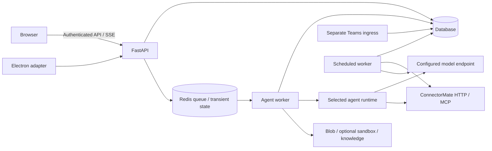
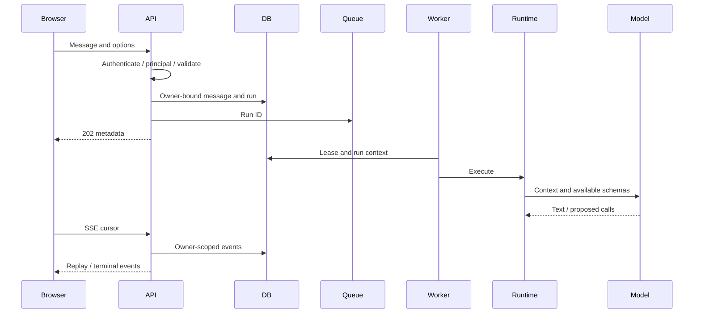
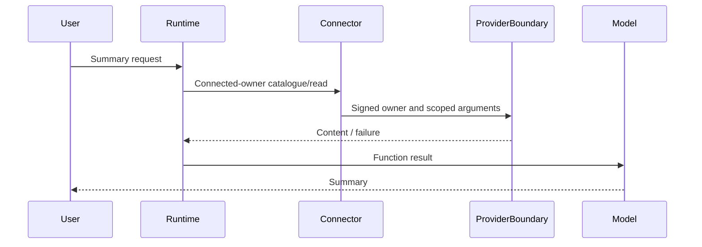
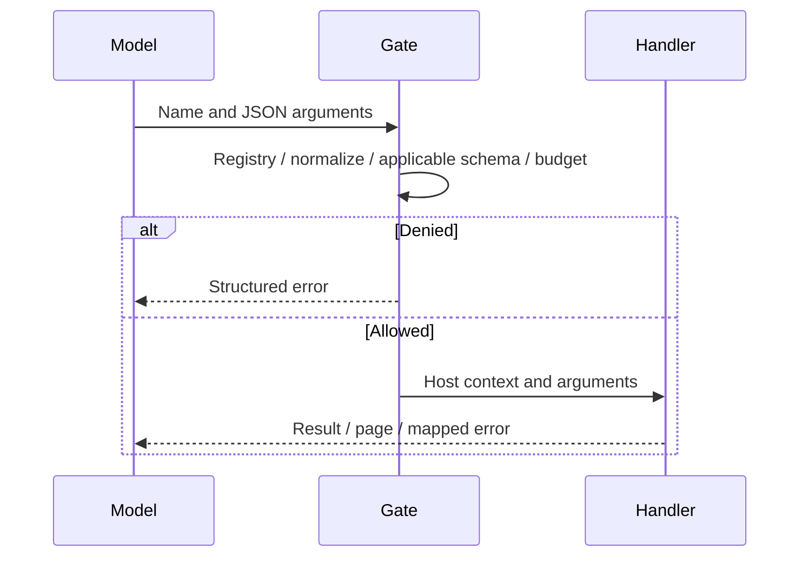
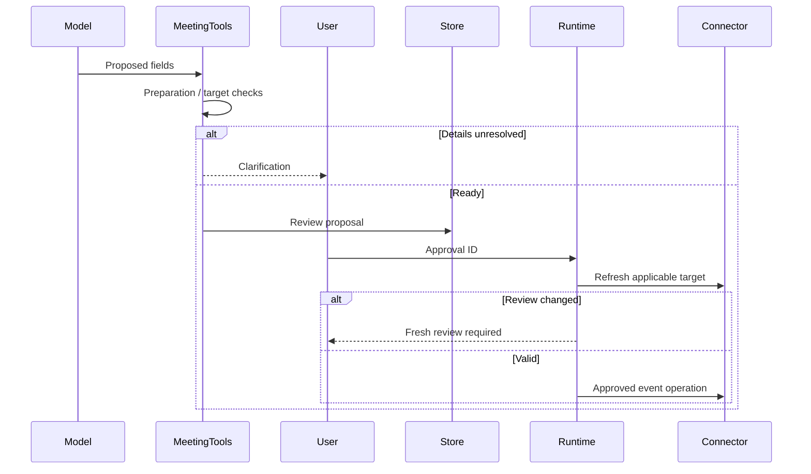
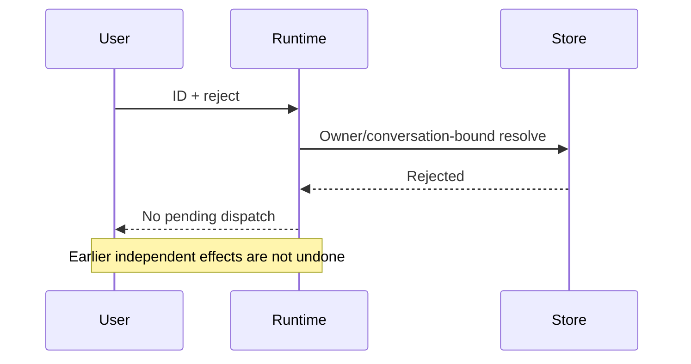
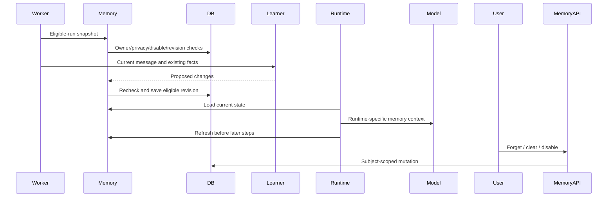
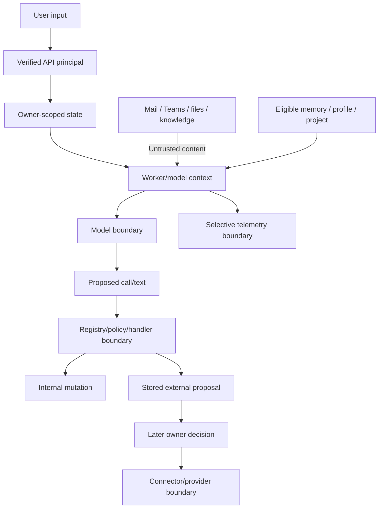
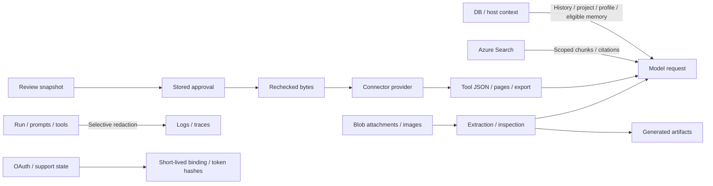

# ChatMate Mapper — Source-Backed Behavioral Blueprint

> **Architecture, QA, security-boundary, and behavioral-fidelity reference**
>
> Inspected revision: `9335db39cd92f98cbefb91ffb98bb995fe32048b`.
>
> **No tests were executed.** No applications, builds, migrations, project scripts, dependency installations, model requests, Microsoft requests, or live-service queries were performed.
>
> **PARTIAL INVENTORY / BOUNDED REVIEW:** this is not an exhaustive tool, handler, deployment or test audit. Sections 8 and 10 describe executable control flow and native contracts. Sections 21 and 23 distinguish a limited initial fidelity claim from conditional extensions and deterministic fixture expectations. External Microsoft authorization remains unverified.

## 1. Purpose, scope, and non-claims

This document describes the available ChatMate implementation and the observable security-relevant semantics a future synthetic system would need to preserve. It separates executable behavior, test assertions, documentation, interpretations, and missing evidence.

**Reading order:** use Section 21 to identify the claimed fidelity boundary; Section 8 for the source-derived model/tool state machine and prompt layout; Section 10 for native contract projections and the broader partial inventory; Section 7 for the approval decision's second-turn placement; Section 17 for event delivery; and Section 23 for conceptual fixture comparisons and ordinary expected traces. The broader capability inventory is reference material, not a requirement to implement every feature in an initial slice.

It does not:

- Establish deployed topology, enabled flags, effective Microsoft permissions, or production use.
- Demonstrate a production vulnerability or provide attack payloads or bypass instructions. Section 23's named-defect comparisons are conceptual synthetic fixture designs only.
- Treat passing-looking test assertions, comments, UI labels, prompts, dependencies, or plans as execution results.
- Infer source-system isolation merely from ChatMate ownership checks.
- Specify implementation architecture or code for a synthetic target.

**Citation bases**

- `A/` = `services/chatmate-api/src/chatmate_api/`
- `T/` = `services/chatmate-api/tests/`
- `W/` = `apps/web/src/`
- `C/` = `packages/features/chat/src/`
- `P/` = `packages/api-client/src/`

Abbreviated citations expand to repository-relative paths. Stable symbols identify behavior where a full file contains several contracts.

**Notation:** “Section N” refers to this document; citation suffixes such as `:183-305` are source line ranges. Native identifiers remain in code spans. `≠` distinguishes states or evidence categories, not an execution transition. Fixture labels such as owner-A are fabricated identifiers; source defaults and synthetic overrides are labelled separately.

## 2. Executive summary

| Finding | Evidence and qualification |
|---|---|
| ChatMate is substantially beyond scaffold. | **CONFIRMED:** product routers and executable chat/worker/model/tool paths exist. `A/api/router.py:38-69`; `A/api/agents.py:381-431`; `A/workers/agent.py:173-260`. |
| Root scaffold descriptions are stale. | **DECLARED:** `AGENTS.md:5-9`, `CLAUDE.md:5-13` contradict inspected registrations and execution wiring. |
| Main chat is asynchronous and database-backed. | **CONFIRMED:** persist message/run, enqueue run ID, return202, execute in worker, replay owner-scoped events. `A/api/agents.py:381-431,490-539`; `A/services/run_events.py:50-96`. |
| Deterministic, v1, and v2 paths coexist. | **CONFIRMED, conditional:** default configured model runtime is v2; v1 remains selectable/shared/fallback. `A/agents/providers.py:8021-8089`; `A/config.py:466-484`. |
| Model calls do not establish authenticated identity. | **CONFIRMED:** principal, connector owner, actor, run and registry are host-controlled. `A/api/deps.py:101-149`; `A/agents/kernel/policy.py:65-119`. |
| Interactive classified connector writes stage before execution. | **CONFIRMED, conditional:** stored proposal, owner/conversation-bound decision, capability/file checks and later dispatch. `A/agents/toolsets/connector_writes.py`; `A/agents/providers.py:6463-6757`. |
| Approval is not universal for all side effects. | **CONFIRMED:** personal tasks, memory, artifacts, scheduled drafts and activated scheduled Teams delivery have different rules. `A/agents/user_task_tools.py`; `A/workers/scheduled.py:1248-1475`. |
| File delivery has substantive local binding checks. | **CONFIRMED:** owner/conversation lookup, clean upload status, limits, byte/hash checks and reviewed snapshot comparison. `A/agents/teams_files.py:179-269`; `A/agents/providers.py:6383-6461`. |
| Memory is implemented, eligible, revocable and refreshed. | **CONFIRMED, conditional:** worker rollout gates, durable eligibility/revision checks, v2 later-step refresh, maintenance loop. `A/workers/agent.py:307-377,692-740`; `A/agents/kernel_agent.py:1030-1055`. |
| Categorical employee mail/Teams isolation remains unverified. | **UNKNOWN:** Microsoft token-account/resource enforcement lives beyond the inspected connector client. Host ownership does not establish provider authorization. |

## 3. Analysis methodology and repository coverage

**Commands actually performed during the mapper investigation:** read-only `git status --short` and `git rev-parse HEAD`, repeated during the investigation. File inspection used directory reads, filename matching, content searches and source reads. No project executable code was imported or run.

Git reported the revision above. During the original review `.opencode/` was untracked; during targeted verification this report was also untracked. No tracked changes were reported. Existing user work was preserved. Git status is not an attestation about ignored files.

Root instructions were inspected. Instruction-file searches returned root `AGENTS.md` and `CLAUDE.md`; no nested copies were returned. Their operational commands were not executed.

| Coverage | Inspected | Remaining limitation |
|---|---|---|
| Entry/configuration | App factory, routers, selected settings/manifests, worker deployment template | Full deployment/CI/schema rendering not inspected or executed. |
| Browser | Entry/auth adapter, submission, SSE recovery, approval controls | All route compositions, renderers and desktop IPC not audited. |
| Identity | JWT/direct Entra, principal/connector identity, support lifecycle, sharing caller/store | All admin/desktop/session paths and operational authorization incomplete. |
| Agent | Worker construction, v2 context/loop/policy, shared approval path | Full v1 and every specialist/sub-agent loop incomplete. |
| Tools | Local registrations and many schemas/handlers, file resolver, code/workspace boundaries | Not every nested schema/sink; external registry unavailable. |
| Data/state | Conversations, sharing/forks, memory, search filter, approvals, scheduled delivery/purge | Universal retention, backups, blob/index cleanup not established. |
| QA | Selected unit/integration assertions and fixture behavior | No tests, passing reports, numerical coverage or runtime validation. |

No credential stores, secret-bearing environment files, raw employee datasets or private conversation dumps were intentionally accessed. Incidental source configuration values were not reproduced or validated. No private URLs, tenant IDs, employee identities, credentials or proprietary prompt text appear here.

Material questions are recorded in Section 25; safe local inspection proceeded without guessing deployment facts. Targeted verification for the behavioral contracts covered the kernel loop, policy/results/state, runtime-limit wiring, prompt builder, approval dispatcher/store, message schemas and SSE serializer. Source inspection is not execution evidence.

## 4. Confidence/evidence legend

| Label | Meaning |
|---|---|
| **CONFIRMED** | Direct executable implementation/configuration evidence; activation qualified separately, including inactivity on a specified path. |
| **TEST-EVIDENCED** | Assertion inspected, not run; not production proof. |
| **INFERRED** | Explicit interpretation, not established behavior. |
| **DECLARED** | Documentation, comments, descriptions or UI/model guidance without independently traced enforcement. |
| **UNKNOWN** | Unavailable evidence, incomplete inspection or unresolved distinction. |
| **NOT IMPLEMENTED** | Reserved for evidenced stubs/absence, not incomplete investigation. |
| **OUT OF SCOPE** | External or operational state outside permitted inspection. |

These labels distinguish implementation from test and interpretive evidence. “Unknown” means neither safe nor vulnerable, and a test name is not an inspected assertion.

**Principal evidence map:** app→`A/main.py`; routes→`A/api/router.py`; browser→`W/lib/auth/hooks.ts`, `C/use-agent-chat.ts`; lifecycle→`A/services/conversations.py`, `A/workers/agent.py`; runtime→`A/agents/kernel*`; integrations→`A/services/connectormate.py`; state→`A/repositories/agent_store.py`, `A/services/personal_memory.py`; side effects→shared provider execution and scheduled worker; telemetry→`A/observability/*`. Narrow citations follow each material behavior.

## 5. Repository and component map

| Component | Confirmed construction and activation |
|---|---|
| Workspaces | pnpm apps/packages/features/services membership; root Turbo commands. `pnpm-workspace.yaml:1-5`; `package.json:6-34`. |
| Browser | React19, Vite, TanStack Router/Query, Zustand and OIDC dependencies; authentication/query/router stack mounted. `apps/web/package.json`; `W/main.tsx:25-40`. |
| Shared packages | API client, chat composition, UI and feature packages are source dependencies. Dependency alone does not establish a route. `apps/web/package.json:19-36`; `CLAUDE.md:37-47`. |
| Desktop | Electron main imports auth, relay, agent, integrations, knowledge and notifications modules; single-instance lock. Full IPC audit incomplete. `apps/desktop/src/main/index.ts:26-58,155-165`. |
| API | Python3.12/FastAPI/Pydantic/SQLAlchemy async/Redis/HTTPX/JWT/MCP/Azure/Langfuse. `services/chatmate-api/pyproject.toml:5-45`. |
| API resources | Lifespan constructs database, queue, connectors, OAuth, events, metering and blob stores; knowledge/quarantine conditional. Startup initializes stores. `A/main.py:49-113`. |
| Agent worker | DB execution lease, model/connector/storage services, native tasks, memory closures and conditional specialists. `A/workers/agent.py:110-171,173-425`. |
| Teams ingress | Separate aiohttp `/api/messages` process with SDK authentication decorator. `A/teams/app.py:79-123`. |
| Scheduled worker | Dispatcher/execution/delivery/recovery/purge roles; separate lifecycle from interactive approvals. `A/workers/scheduled.py`, `ScheduledWorker`. |
| Other workers | Launch definitions for knowledge, OneDrive sync, artifact imports, automation and Teams. Their complete execution paths were not audited. `package.json:19-29`. |
| Deployment | Worker deployments render only for enabled catalogue entries; conditional secret/config/gateway-token references. No installed topology inferred. `infra/helm/chatmate/templates/deployment-workers.yaml:1-58`. |

**Configuration loading:** `Settings` uses `CHATMATE_API_`, an environment-file source, case-insensitive names and hidden input values in configuration errors. No environment file was read or settings object evaluated. `A/config.py:111-118`.

**Variable names/purposes only:** all following names carry `CHATMATE_API_`:

- `DATABASE_URL`, `REDIS_URL`: backing stores.
- `AUTH_MODE`, `ENVIRONMENT`: authentication/environment branches.
- `OIDC_ISSUER`, `OIDC_AUDIENCE`, `OIDC_JWKS_URL`: JWT trust.
- `ENTRA_TENANT_ID`, `ENTRA_CLIENT_ID`, `ENTRA_ALLOWED_DOMAINS`, `ENTRA_DIRECTORY_IDENTITY_CLIENT_ID`: direct identity/domain policy.
- `PARAMOUNT_ENTRA_TENANT_ID`, `PARAMOUNT_ENTRA_CLIENT_ID`, `PARAMOUNT_OIDC_AUDIENCE`: secondary trusted registration.
- `CONNECTORMATE_ENABLED`, `CONNECTORMATE_BASE_URL`, `CONNECTORMATE_JWT_PRIVATE_KEY_B64`, `CONNECTORMATE_JWT_ISSUER`, `CONNECTORMATE_JWT_AUDIENCE`: integration activation/address/signing references.
- `CONNECTORMATE_MCP_ENABLED`, `CONNECTORMATE_TRANSPORT`: transport selection.
- `MODEL_PROVIDER`, `AGENT_RUNTIME`, `AGENT_TOOL_EXPOSURE`: orchestration.
- `AZURE_OPENAI_RESPONSES_URL`, `AZURE_OPENAI_API_KEY`, `AZURE_OPENAI_AUTH_HEADER`: model endpoint/auth reference.
- `MODEL_PRO_DEPLOYMENT`, `MODEL_SWIFT_DEPLOYMENT`, `MODEL_AUTO_DEPLOYMENT`, `MODEL_FREE_URL`, `MODEL_FREE_API_KEY`, `MODEL_FREE_MODEL`: profile mapping.
- `PERSONAL_MEMORY_ENABLED`, `DLP_PROVIDER`, `DLP_SCAN_URL`, `DLP_API_KEY`, `SUPPORT_TENANT_GRANTS`: rollout/scanner/support policy.

Sources: `A/config.py`, `Settings`; `A/services/dlp.py`, `build_dlp_scanner`. Effective configuration remains **UNKNOWN**.

## 6. End-to-end architecture



**Evidence:** `W/lib/agent-api.ts`; `A/main.py:49-113`; `A/api/agents.py:381-431`; `A/workers/agent.py`; `A/agents/kernel_agent.py`; `A/teams/app.py`; `A/workers/scheduled.py`. Desktop relay internals remain incompletely traced.

Main browser lifecycle:

1. Credential attachment is restricted to configured API origin; local-dev uses cookies.
2. Middleware validates identity/project access; dependency derives principal/connector owner/support actor.
3. Message schema/service checks content/options, ownership, credits, timezone and relevant artifact version.
4. Service persists run context; route then queues ID and returns202.
5. Worker acquires lease, loads run/profile/organization and builds executor.
6. Executor constructs authorized history, selected knowledge and conditional runtime tools.
7. Runtime builds model requests, applies policy/handlers to calls and stages classified writes.
8. Database event feed provides owner-scoped SSE replay.

Sources: `W/lib/auth/hooks.ts:23-49`; `A/auth/middleware.py`; `A/api/deps.py:101-149`; `A/services/conversations.py:304-638`; `A/api/agents.py`; `A/workers/agent.py`; `A/services/run_events.py`.

**Ordering qualification:** factory adds body-limit, selected auth and then CORS middleware. Framework wrapper order, not source registration order alone, determines request execution. `A/main.py:241-272`.

## 7. Request lifecycle and sequence diagrams

All seven diagrams describe inspected call shapes, not execution outcomes.

**Ordinary chat — CONFIRMED, provider-dependent**



Evidence: `A/api/agents.py:381-431,509-539`; `A/workers/agent.py:173-245`; `A/services/run_events.py:67-96`.

**Mail/Teams summary — conditional, exact Microsoft read contract UNKNOWN**



Evidence: `A/agents/toolsets/connectors.py:105-247`; `A/services/connectormate.py:478-625,881-913`. Provider resource filtering cannot be filled in from this caller.

**Read tool — CONFIRMED policy/dispatch**



Evidence: `A/agents/kernel/policy.py:65-140`; `runner.py:501-593`; `pages.py:38-74`.

**Interactive send — conditional classified connector write**

```mermaid
sequenceDiagram
 Model->>Runtime: Write proposal
 Runtime->>Store: Prepared exact plan + expiry
 Runtime-->>User: Review and approval ID
 User->>API: New message with approval ID and decision
 API->>Store: Persist decision message and new run
 API->>Queue: Decision run ID
 Worker->>Runtime: Restore host identity and decision metadata
 Runtime->>Store: Resolve stored approval before main model loop
 alt Rejected / expired / unavailable
  Runtime-->>User: Host decision response; no pending dispatch
 else Approved or eligible same-run redelivery
  Runtime->>Runtime: Capability/file/target checks or recorded-result replay
  Runtime->>Connector: Dispatch pending stored action, if any
  Connector-->>Runtime: Receipt / failure / uncertain outcome
  Runtime->>Store: Execution outcome
  opt Continuation needed
   Runtime->>Model: Executed-action context and recorded results
   Model-->>Runtime: Remaining response or new proposals
  end
 end
```

**CONFIRMED:** approval is not a model call that reconstructs the previously reviewed action. The browser submits an ordinary new answer message carrying `connector_approval`; the API persists/queues it. `KernelAnswerAgent.stream` invokes host `decide` before building the ordinary connector/model continuation. Approved arguments come from stored approval data. Evidence: `C/use-agent-chat.ts:1659-1669`; `A/api/agents.py:387-431`; `A/services/conversations.py:535-558`; `A/agents/kernel_agent.py:852-909`; `A/repositories/agent_store.py:1638-1706`.

**Decision branches:** host text ends the decision response immediately; approved retrieval can use `_answer_from_approved`; ordinary successful execution can return a fixed summary or seed a later model continuation. A returned `None` decision triggers the explicit fallback branch. Do not model every decision as an automatic fresh main-loop call. `A/agents/toolsets/approval_decisions.py:220-268`; `A/agents/kernel_agent.py:873-909`.

**Replay boundary:** an approved record does not authorize arbitrary subsequent runs. Store resolution returns the saved action on approved-state replay only when saved execution records all belong to the supplied run ID; eligible records are then replayed by the shared execution path. A different decision run is not equivalent to redelivery of the original decision run. `A/repositories/agent_store.py:1677-1699`; `A/agents/providers.py:6515-6569`.

**Meeting schedule/change — conditional**



Evidence: `A/agents/toolsets/connector_writes.py:237-274`; `approval_decisions.py:150-232`. Full attendee/resource policy is not established.

**Rejection/failure — CONFIRMED branch distinction**



Evidence: `A/agents/providers.py:6490-6505`; `A/repositories/agent_store.py:1638-1706`. Execution failures separately preserve uncertain/partial outcomes.

**Multi-turn memory — CONFIRMED, conditional**



Evidence: `A/workers/agent.py:307-377`; `A/agents/executor.py:1107,2591-2608`; `A/services/personal_memory.py:264-402`; `A/agents/kernel_agent.py:1030-1055`.

## 8. Model and agent orchestration

| Area | Confirmed behavior | Qualification |
|---|---|---|
| Provider selection | `build_answer_agent` constructs v1, returns v2 when selected, deterministic otherwise | Full provider validation/import execution not run. `A/agents/providers.py:8021-8089`. |
| Profiles | Pro/Swift deployment fallbacks; Auto configured router else Pro path; free requires URL/key/model and HTTPS | Actual model/locality/provider policy unknown. `model_endpoints.py:61-135`. |
| Router | Kernel uses Chat Completions adapter for router endpoint | Returned unapproved model logs error; local billing helper is not provider-selection enforcement. `kernel_agent.py:1310-1324`; `model_endpoints.py:138-162`. |
| Prompt order | Core instructions; developer capability/provider/stable block; omitted-history note/summary; history; current turn; run transcript | Ordering is model representation, not authorization. `kernel/context.py:131-205`; `kernel_agent.py:1386-1465`. |
| Stable sections | Organization, project, user profile, memory | Full editorial authority review incomplete. Same sources. |
| Grounding | Rules developer-role; evidence user-role; citation metadata | Reading permission does not make source instructions authoritative. `kernel_agent.py:1430-1437`; `knowledge_tools.py`. |
| Arguments | JSON object required; normalizer before applicable schema | Invalid upstream schema may be logged and left unenforced; connector writes set kernel `validate=False`. `kernel/policy.py:89-140`; `toolsets/connector_writes.py:144-166`. |
| Tool loading | Skill exposure requires loading; deferred loading optional by default | Discovery does not add authority. `kernel/policy.py:59-87`; `kernel/builtins.py:29-54`. |
| Limits | Separate round/call/load/context/time and per-pool limits; see Section 8.3 | Not a universal 24-tool cap. Host wiring overrides some bare kernel defaults. `A/config.py:422-484`; `A/agents/kernel_agent.py:316-332`; `kernel/state.py:20-43`. |
| Parallelism | Marked parallel-safe calls can run concurrently; indexed result order retained | Shared DB session tools intentionally not generally concurrent. `kernel/runner.py:495-535`; `toolsets/runtime.py:40-65`. |
| Output/context | Held/compacted result handles included in checkpoint state | Provider context window/universal token cap unknown. `kernel/pages.py:21-93`. |
| Streaming | Responses requests use stream, `store=False`, optional reasoning/tools/format/token fields | Does not prove provider retention; no hidden reasoning inspected. `kernel/model.py:159-182`. |
| Retry/error | Retry eligible HTTP failures only before yielded events; jitter; malformed response mapped | Full adapter/provider retry policy not universal. `kernel/model.py:184-208`. |

Paths without a prefix in this table are under `A/agents/`.

### 8.1 Source-derived loop and termination contract

**CONFIRMED — v2 kernel control flow, not synthetic implementation code.** `AgentRunner.stream` maintains a round counter, transcript, loaded names, staged actions, failure streaks, provider state, budgets and paged results. A kernel outcome is distinct from a persisted HTTP run status and from a connector execution status.

| Stage | Source behavior and observable consequence |
|---|---|
| Prepare next step | Before a later resumable step, checkpoint through the hook; increment round; refresh product context on rounds after the first when a refresh callback exists; build request. A forced recovery step narrows tools to its named tool and disables parallel tool calls. |
| Consume model step | Accumulate text, ordinary calls and search calls; process usage/commentary hooks; require a `Completed` event. Append its `output_items` to the transcript. A failed/incomplete step decrements the round bookkeeping and propagates; it is not a normal final answer or generic v1 fallback. |
| No calls/searches | Empty text with neither staged actions nor a catalogue appendix is a model error. Otherwise a permitted `before_final` repair may add a repair instruction and continue. Without a repair, return `AwaitingApproval` if staged actions remain, otherwise `Final`. |
| Too many calls in a batch | Count ordinary calls plus search calls. If above `calls_per_round`, execute none; append correlated rejection outputs for ordinary calls and empty search outputs. First oversized batch permits another step; the second oversized batch returns a replacement `Final` with fixed step-limit text. |
| Policy decisions | Provider preparation runs, then policy decisions and budget charges occur in model-call order. Unknown/blocked, streak, exposure, JSON-object, normalizer, applicable schema, support-write and pool checks precede allow/stage. An invalid call is answered; it does not silently disappear. |
| Dispatch | Multiple allowed parallel-safe calls can run concurrently within `parallel_reads`; outputs remain indexed in original call order. Remaining calls execute in order. A halt result prevents later not-yet-run calls and yields `not_run`; policy decisions/charges have already occurred. Fatal/cancellation errors propagate; unexpected nonfatal handler errors become `tool_failed`. |
| Correlate results | Append one `function_call_output` per ordinary call, keyed by the original `call_id`, with serialized `result.output`. Collect provider after-round effects, notes, clarification, forced next step and discard/stop signals. Additional loaded schemas/images are appended in their dedicated forms, not substituted for the call result. |
| Reconcile staged batch | An explicit discard or a write error that does not preserve the batch, excluding execution-budget exhaustion, invalidates the proposal batch. Clear all staged actions when discarded. Failed batches may receive bounded repair opportunities; stop when the repair bound is exceeded, rounds end, or execution is exhausted. This does not roll back already performed reads or internal effects. |
| Select next outcome | Precedence after reconciliation is fixed stop → forced next step → clarification (`AwaitingInput`) → exhaustion/deadline/credits break → next ordinary step. Thus a clarification or fixed stop can take precedence over an exhaustion path. |
| Exhausted main loop | `_partial` first yields `AwaitingApproval` when staged actions remain. Otherwise it returns empty `Partial` when partial summarization is disabled, or makes an additional summary request with `tool_choice="none"` and returns `Partial(reason=rounds/budget/time/credits)`. The tool list is retained for cache layout; this is not a normal tool-dispatch round and is not a universal empty-tools request. |

Sources: `A/agents/kernel/runner.py:183-305,308-435,449-593,650-688`; `A/agents/kernel/policy.py:65-119`; `A/agents/kernel/tools.py:53-107`; `A/agents/kernel/state.py:255-287`. Batch repair constant: `A/agents/kernel/runner.py`, `BATCH_REPAIRS`.

**Staging/deduplication:** a write handler must return a staged action, error or interrupt. A nonstaged success from a write handler becomes `write_not_staged`. Matching executed ledger entries return `already_executed`; matching staged fingerprints return `already_staged`; these duplicate cases refund the selected pool charge. Fingerprints depend on tool/arguments, not model call ID. This does not establish exactly-once external delivery. `A/agents/kernel/runner.py:595-625`; `A/agents/kernel/state.py:93-130,169-174`.

**Do not flatten failures:** ordinary read errors can be returned to the model for recovery. Some write guards preserve a staged batch; invalid proposal errors may discard it. Control-pool exhaustion differs from noncontrol execution exhaustion. A kernel `AwaitingApproval` is an agent outcome; the exposed run enum has no awaiting-approval state. A completed answer can carry a still-pending approval. `A/agents/kernel/runner.py:515-522,377-425`; `A/agents/kernel/policy.py:109-118`; `A/db/models.py:146-152`; `A/repositories/agent_store.py:2817-2867`.

### 8.2 Ordered prompt/context skeleton

**CONFIRMED — structure only; no proprietary instruction text.** The Responses request's top-level `instructions` is separate from ordered input items. Tools are a separate request field. Do not reinterpret everything as a single system prompt.

| Order | Role/provenance | Inclusion condition |
|---|---|---|
| Separate request field | Core application instructions plus policy guidance | Set by `_turn`; not derived from a tool's returned content. |
| Input 1 | Developer block: capability-group index, provider guidance, then stable organization/project/profile/memory sections | Present when sections exist; source/user data inside a section does not thereby become deterministic authorization. |
| Input 2 | Developer omitted-history notice; optional user-role derived summary | Only when history has been omitted; summary is explicitly derived context. |
| Input 3 | Earlier conversation items | Windowed history through `message_items`; ordinary text retains its role. Assistant attachments can produce a separate user-role reference item. Earlier tool ledger is appended to assistant text. |
| Input 4a | Developer grounding guidance, then user-role grounding evidence | Only when grounding context exists. |
| Input 4b | Developer runtime time/timezone and applicable change/image notes | Built from host runtime/context; not a grant of connector authority. |
| Input 4c | Latest message/reference attachments | Current user text preserves the API-bounded input rather than the smaller ordinary history-message budget. |
| Input 4d | Resumed connector receipts; executed-action continuation; routing context; draft context | Conditional, in that order. Resumed receipts are skipped when the checkpoint transcript already contains them. These helpers have their own item/role forms; do not assign one universal role to all receipts. |
| Input 5 | This run's accumulated model output and correlated tool results | Append-only between normal rounds, subject to explicit compaction/recovery; returned images follow function outputs. |

Sources: `A/agents/kernel/context.py:131-220`; `A/agents/kernel_agent.py:397-445,1386-1465`; `A/agents/kernel/runner.py:328-375`.

The v1/v2 memory-role distinction and later-step memory refresh described below remain part of fidelity. Omitted-history summaries, run-local tool output pages and durable personal memory are different state categories.

### 8.3 Limits, charging and explicit fallback

**CONFIRMED:** bare `RuntimeLimits` defaults are not identical to the product's `runtime_limits(settings)` construction.

| Limit | Bare kernel default | Product v2 wiring/default or qualification |
|---|---|---|
| Main rounds / calls per round | 24 / 8 | Settings-controlled, normally 24 / 8; partial-summary step is described separately above. |
| Execution pool | 24 | `agent_execution_max_calls`, default 24. |
| CRM / F&O / Graph pools | 64 each | Separate settings-controlled pools, normally 64 each. |
| Discovery pool | 32 | Product constructor supplies 64. |
| Meetings pool | Not in bare default | Product constructor supplies 512; meeting orchestration/read charging still depends on toolset behavior. |
| Loaded tools | 32 | Settings-controlled; this is not total executable-call allowance. |
| Output / working context | 32,000 / 240,000 characters | Settings-controlled; not token counts. |
| Wall-clock / parallel reads | 1,800s / 4 | Product supplies configured wall-clock; parallel reads remains kernel default in this constructor. |

Sources: `A/agents/kernel/state.py:20-43`; `A/agents/kernel_agent.py:316-332`; `A/config.py`, `Settings` fields. `Budget.charge/refund` uses the named pool or falls back to execution for an unknown pool. Policy charges the tool's pool before allow/stage; noncontrol pool exhaustion sets `state.exhausted`, while a control denial does not do so automatically. `A/agents/kernel/state.py:73-90`; `A/agents/kernel/policy.py:109-118`.

**Explicit v1 fallback, not general error recovery:** factory selection returns v1 when runtime is not v2. Within v2, `serves` currently requires `agent_run_id or run_id`; absence falls back. An approval without connector/store/write support falls back; connector wiring with missing confirmation store raises instead. An unhandled decision returning `None` falls back. A loaded connector catalogue with writes but no shared write support falls back. Invalid arguments, tool errors, provider failures and exhausted budgets are not blanket fallback triggers. `A/agents/providers.py:8021-8089`; `A/agents/kernel_agent.py:740-753,777-805,852-915`.

Deployment overrides and provider-managed limits remain **UNKNOWN**. A review limited to v2 may explicitly exclude v1 parity; it must not describe exclusion as evidence that v1 is absent.

**v1/v2 memory difference:** v1 inspected test asserts memory is user-role data, before current request and outside top-level instructions. v2 adds memory to stable sections assembled into developer content. This is a real layout distinction; textual guidance does not erase role placement. `T/unit/test_personal_memory.py:29-75`; `A/agents/kernel_agent.py:1401-1423`; `kernel/context.py:131-150`.

**Refresh now confirmed:** v2 reloads memory before later model steps, replacing/removing the prior memory section when changed. `A/agents/kernel_agent.py:1030-1055`. The worker records memory-context counts and learned IDs, not fact text, in those events; failures continue without memory. `A/workers/agent.py:307-377`.

**Response replacement:** v2 may hold prose after staging or meeting engagement, then reconcile review/list/clarification output with already shown text using answer-reset behavior. Approved-continuation model failure preserves the executed-action summary rather than implying actions never ran. `A/agents/kernel_agent.py:1056-1141`.

**Other agents:** title/history/memory helpers, attachment inspection, code, analysis, interactive generation and document/deck specialists are conditionally wired. Full classifiers/evaluators/moderation or specialist-loop contracts remain incompletely reviewed. `A/workers/agent.py:41-51,347-425`; `A/agents/executor.py:1699-1847`.

## 9. Capability matrix

| Capability | Implemented scope | Activation/limit |
|---|---|---|
| Conversations/history/rename/archive/delete | Registered owner-bound use cases | Soft delete shown; other retention separate. `A/api/agents.py`; `repositories/agent_store.py:833-866`. |
| Browser chat/SSE/recovery | Submit/stream/current-generation handling, read-only terminal recovery | Worker/backing dependencies required. `C/use-agent-chat.ts:1048-1093,1382-1458`. |
| Mail/Teams/calendar/files | Dynamic connectors plus local preparation/wrappers | Registry/connection/provider contracts conditional. `A/agents/toolsets/connectors.py`; `providers.py`. |
| Knowledge/citations | Selected-space search with tenant/user filters and active-doc recheck | Azure search/index metadata correctness external. `A/knowledge/search.py:91-185`; `agents/knowledge_tools.py`. |
| Documents/decks/images/analysis | Intent routing, native tools, versioned persistence | Specialist/production/workspace flags and dependencies. `A/services/conversations.py:418-512`; `agents/executor.py:1699-1862`. |
| Sharing | Owner adds/removes viewers; member reads/forks text | Does not transfer original attachment/source access. `A/services/conversation_sharing.py:120-217`. |
| Support | Audited short-lived admin-to-target session | Same tenant or exact configured cross-tenant grant; mutation restrictions. `A/services/support_sessions.py`; `api/deps.py`. |
| Personal tasks | Immediate internal changes, timeline/reminders | Owner/version/idempotency paths. `A/services/user_tasks.py:133-272`. |
| Scheduled automation | Draft/activation, owner checks, generation, inbox/chat/email/Teams delivery | Scheduled Teams no per-run approval; email distinct approval. `A/services/scheduled_tasks.py`; `workers/scheduled.py`. |
| Personal memory | Preferences/facts/learn/use/forget/clear/disable/purge | Rollout and privacy eligibility. `A/services/personal_memory.py`; `workers/agent.py`. |

## 10. Native contracts and partial tool inventory

**Completeness boundary:** The inventory records confirmed local names and registration families. It is **not a claim that every possible runtime tool or nested specialist tool was exhaustively inspected**. Connector definitions come from a dynamic external registry; some schemas are generated from external metadata. Exact absent fields are not invented.

### Native contract projections for the initial fidelity boundary

The following are **CONFIRMED source-derived projections**, not new adapter schemas and not complete copies of the full native records. Required/nullable/default distinctions matter. Any normalized interface in Section 22 remains a candidate label, not a native wire name.

| Boundary/native symbol | Fields needed to understand the observed contract | Interpretation |
|---|---|---|
| Message submission — `MessageCreate` | `content`; default `model_tier=pro`, `intent=answer`; optional `connector_approval`; other artifact/upload/skill/choice options documented in this inventory | Content trimmed; requires text or attachment. Approval decisions cannot combine uploads/skills/nonanswer intent. Browser client independently defaults model tier to auto; it is not the API default. No principal/connector-owner field is taken from this body. |
| Accepted response — `MessageAccepted` | `message: MessageRead`, `run: AgentRunRead` | HTTP 202 means accepted, not model completion or connector success. |
| Message record projection | `id`, `conversation_id`, `role`, `content`, nullable model tier, `created_at`; lists/optional citations, activity, artifacts, approval, clarification, failure | Approval metadata is attached to an assistant answer, not necessarily a separate run state. |
| Run record projection | `id`, `conversation_id`, `prompt_message_id`, nullable `result_message_id`, model/agent identity, `status`, nullable error/start/cancel/completion fields | Status enum: queued/running/cancel_requested/cancelled/completed/failed. Keep this separate from kernel outcomes and connector execution states. |
| Model request — `ModelRequest` | `instructions`, `items`, `tools`, `effort`, `cache_key`; defaults `tool_choice=auto`, `parallel_tool_calls=true`; optional round/format/token metadata | Host-built request, not employee-selected authorization context. |
| Scripted model step — `ScriptedRound` | Optional text, ordinary calls, search calls, usage or error | Existing deterministic adapter emits text/calls followed by `Completed`; scripted errors propagate. This proves a local adapter contract, not that the normal production model provider is scripted. |
| Ordinary call — `ToolCall` | Required `call_id`, `name`, JSON-encoded string `arguments`; optional namespace | Arguments are not yet validated objects. Parsing/scoping occurs at policy/handler boundary. |
| Handler result — `ToolResult` | `status=ok/error/staged/interrupt`, object `output`; optional staged action, clarification, images and round effects | `call_id` is supplied by dispatch correlation; it is not a required field inside `ToolResult.output`. |
| Model replay result — `_output` | `type=function_call_output`, original `call_id`, serialized string `output` | Same call ID binds output to the model call. Do not replay a raw object in place of the serialized output field without identifying a translation. |
| Staged model-visible output — `ToolResult.stage` | `status=staged_for_approval`, summary and explanatory message | An internal `StagedAction` separately holds tool/provider/arguments/review. This output does not mean dispatch occurred. |
| Error output — `ToolResult.error` | `error` code; optional message | Do not require every tool's error to use only these fields: native handlers may add detail, failure or retry metadata. |
| Decision request — `ConnectorApprovalRequest` | Required approval UUID and decision approve/reject/review; extra fields forbidden | No replacement action payload or arbitrary execution owner. Sent inside a later `MessageCreate`. |
| Public approval — `ConnectorApprovalRead` | `id`, `expires_at`, pending/expired/superseded/approved/rejected | `missing` is a resolution result, not one of these public approval states. |
| Stored action/execution | Approval identifies connector/tool/arguments; execution identifies action index/run/public tool/argument hash/correlation/idempotency/JTI/status and optional code/result | Execution states prepared/invoking/succeeded/failed/outcome_unknown. Successful receipt is bounded; arbitrary provider output is not a universal receipt schema. |
| Stored event — `RunEventRead` | Integer `id`, run UUID, `event_type`, object `data`, `created_at` | SSE serialization is a different flattened representation; see Section 17. |

Sources: `A/schemas/agents.py:310-320,420-507,728-800`; `P/client.ts:1186-1231`; `A/agents/kernel/model.py:35-110`; `kernel/scripted.py:23-106`; `kernel/tools.py:53-107`; `kernel/state.py:93-130,255-287`; `kernel/runner.py:328-329,687-688`; `A/connector_approvals.py:13-65,94-137`.

**Native effect vocabulary:** kernel policy read/write/control is dispatch policy, not a universal persistence classification. Some tools adapted with ordinary runtime policy create internal artifacts/tasks. Likewise `ToolResult.status=ok` means handler result status, not authenticated external success. Provider receipts and execution outcome classification remain separate.

### Inherited execution contracts

| Contract | Identity, enforcement, effects, errors and visibility |
|---|---|
| **K — kernel controls** | Registry/run-local state; no authority granted by search/load. JSON/policy checks and bounded output; structured result returns to model. `kernel/builtins.py`, `kernel/pages.py`, `kernel/policy.py`. |
| **R — native runtime** | Host run/conversation/owner/dependencies. May persist artifacts/internal state without external approval. Handler validation plus kernel adaptation; common tool failures and result paging. `executor.py:1699-1862`; `toolsets/runtime.py:79-115`. |
| **C — connector reads** | Host connector owner, connected catalogue and organization normalization/checks; external HTTP/MCP call; source results/errors return to model. `toolsets/connectors.py`; `services/connectormate.py`. |
| **W — connector proposals** | Registry `requires_confirmation`; shared preparation, review and stored-ID decision; model loop stages, later execution dispatches stored arguments. `toolsets/connector_writes.py`; `providers.py:6463-7392`. |
| **I — internal task/draft** | Host subject; service owner/version/idempotency checks; immediate internal mutation or draft. Model-visible results; no universal connector approval. `user_task_tools.py`, `scheduled_tools.py`, corresponding services. |

Agent paths above are under `A/agents/`; service paths under `A/`. For every family, unspecified timeout/retry/output fields or downstream authorization are **UNKNOWN**, not an assumed inherited guarantee.

### Controls, context and skills

| Native name | Inputs/defaults/constraints | Output/effect/enforcement |
|---|---|---|
| `tools_list` | Required nonempty scope; no extras | K, catalogue display, not source read. `kernel/builtins.py:94-113`. |
| `tools_discover` | Group, offset≥0 | K, v2 page20; older catalogue page12. `kernel/builtins.py:25,115-135`; `tool_catalogue.py:94-100`. |
| `tools_search` | Nonempty query | K, registry search. `kernel/builtins.py:136-151`. |
| `tools_load` | Names bounded per call and loaded-tool budget | K, only authorized loadable entries; skill dependencies separately loaded. `kernel/builtins.py:29-54,152-160`; `tool_catalogue.py:15-17`. |
| Provider `tool_search` | Required goal; no extras | Conditional native-search exposure. `kernel/context.py:24-39`. |
| `tool_result_read` | Handle, integer offset≥0; no extras | Run-held paged/compacted result. `kernel/pages.py:38-74`. |
| `conversation_read` | Strict required nullable message ID and offset≥0 | R/read:12 listings or12k text characters plus file inventory; supplied snapshot IDs only; unavailable ID error. `context_tools.py:13-73`. |
| `knowledge_search` | Strict query1–4,000 | Selected spaces refreshed; tenant/subject filter; active-doc filter; evidence/matches/citation events. `knowledge_tools.py:16-145`. |
| `org_lookup` | Entity/system/section/query selectors; text helper≤200 | Published profile/version result. Full native definition schema not read. `toolsets/organization.py:25-57`. |
| `skill_list` | Optional offset0, limit20, integer checks | Available approved metadata/dependency/audience filter. |
| `skill_load` | Exactly nonempty name | Instructions/version/references; activates available declared dependencies. |
| `skill_read_reference` | Exactly name/path, loaded skill required | Declared reference; repeat status. Cumulative128KiB instruction/reference budget. `skill_tools.py:13-160`. |

### Personal tasks and scheduled drafts

| Native name | Input contract | Result/effect |
|---|---|---|
| `my_tasks_list` | Required Boolean include_done | Today and owner-scoped tasks. |
| `my_tasks_add` | Title1–240; lane now/next/later/waiting; nullable due/follow-up/waiting/note/source/evidence fields | Immediate owner task; agent timeline; tool-call-derived idempotency key. Mail/Teams source label/link stripped in adapter. |
| `my_tasks_update` | Task UUID/version≥1; nullable edits; open/done; clear-list | Locked owner/version update; null means unchanged unless explicitly cleared. |
| `task_preview` | Full task/schedule input | Timezone/next runs/warnings, no saved task. |
| `task_create` | Full input + use_current_knowledge_scope | Host current knowledge IDs when requested; run/call key; draft_requires_activation. |
| `task_list`, `task_get` | Empty object / task UUID | Owner task records and UI link. |
| `task_update` | Full update/task/revision + scope action preserve/use_current/clear | Draft with activation required; knowledge ownership validation. |
| `task_pause` | Task/revision | Owner transition. |
| `task_cancel` | Task/revision | Pauses active task; returns cancellation-confirmation requirement. Does not irrevocably cancel through this native adapter. |

Sources: `A/agents/user_task_tools.py:69-177,183-265`; `scheduled_tools.py:40-245,252-398`; `A/services/user_tasks.py:133-272`; `scheduled_tasks.py:445-523,843-964`.

Shared scheduled input: title≤240, instructions≤12k, reminder/agent, recurrence once/daily/weekdays/weekly/monthly, naive local start plus IANA timezone, optional end/count/weekdays, count≤1,000; sources≤4, knowledge IDs≤10, delivery inbox/email/Teams/chat, nullable email recipient. Free tier rejected; reminders cannot use sources/knowledge; email/Teams need recipient; inbox/chat forbid recipient; chat only agent and no pre-sampled sources. `A/schemas/scheduled_tasks.py:18-112`.

Errors: task validation/conflict/not-found are mapped; scheduled adapter has a generic safe failure fallback. User-task validation output includes validation details, so do not assume all native errors omit offending values. `user_task_tools.py:257-265`; `scheduled_tools.py:362-398`.

### Artifact, production and specialist tools

| Native names | Schema and validation | Output/effect/activation |
|---|---|---|
| Legacy `document_generate`; `html_generate`, `spreadsheet_generate`, `csv_generate`, `tsv_generate`, `pdf_generate` | Strict brief1–16k, skills≤8; request-specific spreadsheet output_index can be required | R/create persisted artifacts. Legacy document omitted when production sandbox supplied. `artifact_tools.py:94-103,705-781`. |
| `artifact_read` | Artifact ID, offset≥0 | Saved content/context; full sink not exhaustively audited. Same source. |
| Production `document_generate` | Strict title1–240, blocks1–500, assets≤100, skills≤8, optional cover; image/plain consistency | Distinct same-name schema; production artifact. `document_production.py:426-449`. |
| `document_inspect`, `document_figure_view` | Attachment ID; figure1–200 for latter | Document/figure reads; full output schema incomplete. `document_production.py:415-423`. |
| `document_edit` | Attachment/title, defaults for bounded replacements, Python≤60k, figure≤20/image≤10 lists | Internal edited document; full nested block/code execution audit incomplete. `document_production.py:381-393`. |
| `document_restyle`, `document_export_pdf` | Attachment/title; color patterns/cover reference for restyle | New/updated document output. `document_production.py:396-413`. |
| `document_image_generate` | Title/prompt; optional document/template/figure references; document/template mutually exclusive | Conditional image generation; artifact/reference handling. `document_production.py:452-467`. |
| `document_org_logo` | Entity ID1–63, variant | Published organization asset selection. `document_production.py:470-480`. |
| `image_generate` | Strict title/prompt, refs≤4, nullable logo; model schema requires nullable logo | Conditional image effect, bound reference/prior-attempt state. Prompt brand rules alone not deterministic enforcement. `image_tools.py:30-144`. |
| `inspect_attachment` | Exactly UUID/question1–2k/kind document or spreadsheet | Grant/conversation/hash checks, dedup key, semaphore2; recorder/sandbox result. `attachment_inspection.py:65-146`. |
| `analysis_schema`, `analysis_create`, `analysis_read` | Empty schema request; document JSON plus nullable dataset/artifact/version; read ID/offset | Persist/read analysis; owner/conversation/kind checks in inspected read. Full source-binding sink incomplete. `analysis_tools.py:36-109`. |
| `interactive_ui_generate` | `InteractiveBrief` validation; full brief fields not enumerated in inspected excerpt | Run fingerprint/UUID dedup; active checks; generation max12k output tokens; two candidate attempts with validator; immutable blob, persisted metadata; ui.started/failed events. `interactive_ui.py:215-359`. |
| `deck_import_attachment` | Attachment UUID | Granted PPTX only; stable per-run import identity; persist/discard handling. `deck_tools.py:255-330`. |
| `deck_describe` | Artifact UUID | Compact version/layout/slides/shapes/warnings; text/shape/slide clipping. `deck_tools.py:135-191,222-235`. |
| `deck_edit` | Artifact UUID, version≥1, summary1–300,1–50 typed operations | Real-file versioned edit via service; persisted expected version; discard on failure; typed errors. Final service resource audit incomplete. `deck_tools.py:93-130,332-397`. |
| `deck_build`, `doc_build` | External canonical JSON tool schemas plus `DeckSpec`/`DocSpec` runtime validation | Spec hash dedup via recorder; one slot; configured deadline; prior result replay; cancellation/timeout/provider/build errors. `deck/tools.py:42-155`; `document/tools.py:41-145`. |
| `deck_brand_kits`, `document_styles` | Empty strict object | Owner passed to catalogue summaries; published/private-draft metadata. Full library authorization sink incomplete. `deck/kit_tools.py`; `document/style_tools.py`. |
| `document_templates` | Required query, no extras | Principal-bound template list; excludes retired/kits, newest families,≤50; fields/image inventory. `template_tools.py:183-213,322-355`. |
| `template_create` | Required template_id/title/values/images/nullable restyle; runtime bounds title≤160,values≤100,images≤50 | Principal template source/hash check; run-local repeated-failure suppression; production integration. Full fill/render checks incomplete. `template_tools.py:118-181,215-320`. |

All paths in this table are under `A/agents/`.

`DeckSpec`: required schema/title/slides;1–40 slides; optional template/revision, defaults language en/freedom guided/citations notes; sources≤100/assets≤12. Runtime checks duplicate IDs, references and chart shapes. `A/schemas/deck_spec.py:59-242`.

`DocSpec`: schema/title/sections;1–60 sections; optional style/revision/page/length; defaults language en/freedom guided/plain cover/numbered headings/references; sources≤100/assets≤20; heading/reference/table-width checks. `A/schemas/doc_spec.py:27-230`. Canonical JSON schema files are loaded by `tool_parameters`; parity with models was not executed.

### Code and workspace boundaries

| Tool/surface | Schema/effects/limits |
|---|---|
| `code_execute` | Strict code1–16k/method1–300; max5 executions; enabled governance/publisher/run identity, excluded from support provider composition. `code_execution.py:62-89,118-179`; `kernel_agent.py:1355-1373`. |
| Code-host bridge names | `tools_list`, `dataset_read`, `crm_records_read`, `finance_operations_records_read`, `file_content_read`, `export_csv`, `export_json`, `export_text`, plus admitted native reads. Separate inner protocol, not unrestricted top-level model tools. Full export/file schemas incomplete. `code_execution.py:306-459`. |
| `sandbox_exec` | Command1–20k, timeout1–180; host workspace ID, per-run command counter. |
| `sandbox_write_file`, `sandbox_read_file` | Bounded path/content; host workspace; read byte bound/UTF8 check. |
| `sandbox_view_image` | Bounded paths; image budget/type/pixel checks/downscale; model-image key. |
| `sandbox_publish` | Path/title/pptx-or-docx; extension check, publish request, archive validation, fingerprinted persistence. |
| `presentation_image_generate` | Title/prompt/PNG-JPEG path; production image then workspace write. |

Workspace sources: `A/agents/sandbox_workspace.py:53-171,173-353`. Shared lock, approved skill-bundle digest verification and error mapping precede operations.

**Conditional registration:** production sandbox/artifact store required; workspace+skills and no reviewed document brief for general workspace path; builders/kits/styles require additional dependencies. `A/agents/executor.py:1762-1847`. Skill loading/supersession enforced through `skill_gating.py`, `toolsets/runtime.py`; exported code alone does not activate it.

**Code data authorization:** only admitted nonconfirmation CRM/F&O/Graph reads, exact configured source sets; refresh/revalidate before reads; no remote schema references; max64 bridge calls; audit hashes; datasets reauthorized. `A/agents/code_execution.py:33-85,134-155,260-459`.

**Platform limit:** adapter validates governance, exact scopes, environment/DLP/endpoint/dedicated identity requirements; transfer budgets and sequential request IDs enforced. Start429 retry bounded; other ambiguous calls not retried; cleanup shielded. Actual network/credential isolation remains a platform dependency. `A/agents/code_sandbox.py:47-95,145-297`.

### Meeting controls and dynamic connector reads/writes

- `meeting_browse`: required mode start/more/refresh; optional purpose list/cancel/cancelled/summary, title/timezone/window/top1–50/organizer_only.
- `meeting_select_event`: required evidence; optional number/event ID/scope/source, source default numbered_list.
- `meeting_cancel_many`: required source/evidence; source selection/listed/date_range/series; bounded unique numbers/dates/occurrences and recurrence pattern.
- `meeting_clarify`: required1–20 questions; optional≤20 choice groups,1–8 options, fixed field categories.
- Optional pending-existing-request field added to calendar target controls.

Schemas: `A/agents/meeting_logic.py:204-395`. Registration is conditional; clarification serves connected-service tasks even without calendar tools. `A/agents/toolsets/meetings.py:233-271`. Complete selector/recurrence sink review remains incomplete.

Local read wrappers:

- `crm_records_read`, `finance_operations_records_read`: `A/agents/crm_retrieval.py`, profiles/definitions.
- `onedrive_items_read`, `onedrive_search_read`, `sharepoint_sites_read`, `sharepoint_libraries_read`, `sharepoint_items_read`, `sharepoint_permissions_read`: `graph_retrieval.py:73-167`.
- `trackmate_records_read`: kinds effort_entries/invoices/payments/milestones/weekly_updates/documents/projects;50 projects,5,000 rows, concurrency4. Full schema incomplete. `trackmate_retrieval.py:30-45`.
- Conditional `zoho_projects_{projects,tasks,comments,tasklists,phases,users,fields,statuses,layouts}_read`: native metadata plus portal discovery; connection binding and portal/project response consistency; live authorization before cached rows. `zoho_retrieval.py:18-28,64-83,102-191`.

External schemas/output remain **UNKNOWN**. Dynamic `ConnectorTool` includes public/internal name, connector, parameters, confirmation flag, organizations, permission metadata and selection kind; metadata validation is not effective permission proof. `A/agents/connector_tools.py:26-161`.

Recognized operations are not automatically exposed: Graph mail/send/draft/reply/forward/update/attachment, chats/messages/conversations, events/respond, files/items, sites/drives/permissions, people search; non-Microsoft CRM/F&O/Entra/PowerBI/Linear/Zoho/TrackMate/Foundry may be supplied. `A/agents/connector_reads.py:15-47`; `A/services/connectormate.py:478-717`.

`directory_user_photo_get` is UI-only, filtered from model catalogue. No complete external inventory is invented.

## 11. Microsoft tenant integration

| Boundary | Observed contract | Unknown |
|---|---|---|
| API direct Entra | RS256/JWKS, configured issuer/audience/client, tenant/OID/v2, delegated access_as_user, reject app identity, app-role mapping | Effective registrations/consent/grants. `A/auth/entra_dev.py:20-98`. |
| Directory policy/profile | Graphv1.0, managed identity, `.default`; verified OID, UPN-domain/guest-style check; profile/manager selects | Actual application permissions/tenant reach. `auth/entra_directory.py:68-160`. |
| Teams entitlement | Client-secret or managed identity, enabled Member, app-role assignments; bounded validated next-links | Deployed roles and revocation timing. `teams/directory.py:18-152`. |
| Delegated connector operations | Signed ChatMate service subject, HTTP/MCP catalogue/invoke, organization checks | Provider OAuth identity/scopes/resource endpoints. `services/connectormate.py`. |
| Teams bot | Separate SDK JWT-decorated ingress/adapter/channel policy | SDK internals and deployed bot permissions. `teams/app.py:79-123`. |
| Azure search/blob/model | SDK/client constructors and model calls | Effective RBAC/network/locality/retention. `main.py`; `knowledge/search.py`; `agents/kernel/model.py`. |

**OAuth local boundary:** state key hashed; Redis record binds subject/connector/nonce hash; TTL, constant-time nonce comparison, atomic successful consumption. Returned authorization URL/state/expiry structurally checked. `A/services/connector_oauth.py:15-67`; `connectormate.py:212-259`. Full callback cookie policy/provider token storage/refresh/expiry/revocation unverified.

**Service tokens:** RS256 subject/issuer/audience/iat/exp/JTI; support actor/session/read-only claims when present. `A/services/connectormate.py:881-913`.

**Signed-confirmation coverage is operation-specific:** agent helper includes server-owned non-Graph families and selected Graph event_respond/mail_reply/mail_forward/mail_draft_create/update/send/mail_update/message_change/conversation_change/item_change. It does not establish universal signed envelopes for every Graph write, such as ordinary send/create families. `A/agents/connector_reads.py:15-47`; `providers.py:6622-6724`. Do not conflate interactive approval with downstream confirmation-token enforcement.

**Microsoft isolation assertion:** verified canonical connector owner and subject-specific connected catalogue are confirmed, but not sufficient to prove an employee cannot access another mailbox/chat. Missing evidence: OAuth account matching; delegated/application scope grants; shared-mailbox/delegation policy; mailbox/chat/channel resource predicates; handling model IDs; provider-side tenant enforcement. This remains **UNKNOWN**, not a demonstrated vulnerability.

**Recipient handling:** file-send preparation checks one chat versus channel shape; scheduled recipient lookup matches exact email/OID in one-on-one chats and requires existing chat. It is not proof of universal recipient authorization or guest policy. `A/agents/providers.py:6339-6376`; `A/services/scheduled_tasks.py:125-183`.

**Pagination/rate:** directory pagination is bounded/prefix checked; Graph wrappers describe partial search/permission visibility. General Microsoft Retry-After/throttling across providers is unknown. Code allocation429 handling is a separate Azure-sandbox contract, not Graph retry evidence.

## 12. Identity and authorization model

| Subject/actor | Provenance/enforcement | Observable behavior |
|---|---|---|
| App principal | Middleware-validated claims/project decision |401/403/503 categories; WorkMate token-hash decision cache default30s. `A/auth/middleware.py:60-113,155-186`. |
| Connector owner | Canonical verified tenant/object identity; conflict rejected; restricted local mapping | Not mutable email or model body. `auth/connector_identity.py:22-41`; `api/deps.py:101-122`. |
| Conversation/run owner | Principal subject persisted and exact store predicates | Ordinary unowned/deleted conversation not found; run/event reads owner-scoped. `repositories/agent_store.py:833-841`; `services/run_events.py:67-96`. |
| Model/agent | Host supplies run context; model proposes names/args | Cannot create a registry/principal by text. `agents/kernel/policy.py`; `kernel_agent.py:831-844`. |
| Support actor/target | Admin original principal plus resolved target session | Separate actor/target persisted; many mutations blocked, chat exceptions remain. `api/deps.py:88-149`. |
| Sharing viewer | Membership subject bound to live conversation | Read/fork only, not ordinary owner mutation. `services/conversation_sharing.py:160-217`; `repositories/conversation_sharing.py:66-91`. |
| Recipient/attendee/resource IDs | Tool arguments plus per-handler/provider checks | Full Microsoft authorization still downstream. |
| Memory owner | Durable eligible run or principal-bound API | Fact deletion exact subject+ID; foreign/unknown facts both unavailable. `services/personal_memory.py`. |

**Support lifecycle now inspected:** admin, not already support, verified connector identity; own tenant plus exact configured administrator-to-target-tenant grants; target must have signed in; reject self. Token hash stored; lifetime30min; resolve checks actor match/admin/revocation/expiry; revoke locks actor/session and records ended event. `A/services/support_sessions.py:40-155`. API requires bounded reason and canonical-looking target, normalizes case and maps denial403. `A/api/support_sessions.py:16-84`.

**Limit:** resolve does not itself show a fresh cross-tenant-grant recomputation; grant-removal behavior for existing sessions is not established beyond expiry/revocation checks. Worker-side support continuation enforcement not fully audited.

**Sharing:** owner adds up to50 viewers; service does not itself perform directory validation of supplied member identity. Membership enforces access; recipient discovery/tenant policy beyond this path remains unknown. Shared view exposes text, attachment/artifact/source titles, not original file/source links. Fork copies user/assistant text only into member-owned conversation; removal does not revoke an already copied fork. `A/services/conversation_sharing.py:65-85,120-217`; `repositories/conversation_sharing.py:145-225`.

**Environment gates:** local-dev local-only/minimum secret length; entra-dev local/staging only; explicit trusted Entra settings. `A/main.py:145-176,242-259`.

## 13. Trust boundaries and untrusted-content handling



Evidence: principal `A/api/deps.py`; context `A/agents/kernel_agent.py`; gate `kernel/policy.py`; approval `providers.py`; telemetry `A/observability/tracing.py`.

- Knowledge evidence uses user-role content/citations; source labels are not commands. `A/agents/knowledge_tools.py`; `kernel_agent.py:1430-1432`.
- History and filenames remain data; conversation tool is snapshot-bound. `context_tools.py`.
- Tool output is function result, potentially paged/checkpointed. `kernel/runner.py`; `kernel/pages.py`.
- Project/profile/memory stable context may occupy developer block in v2. Influence is not independently granted integration authority.
- Scheduled sampled source context is separately user-role fenced, with closing-tag sequence transformed; user instructions remain separate. `A/workers/scheduled.py:825-839`. This is formatting/role separation, not proof against all model influence.
- Attachment grant/hash checks establish what bytes may be inspected, not truthfulness/instruction authority. `attachment_inspection.py:113-146`.
- Full email HTML conversion, forwarded/guest author handling, pasted/reused text and every nested tool sanitizer remain **UNKNOWN**.

## 14. Side-effect and confirmation model

| Effect | Actual preconditions/ordering | Important distinction |
|---|---|---|
| Chat acceptance | Validate then persist; queue afterward | Queue failure can follow durable acceptance. `A/api/agents.py:418-427`. |
| Interactive classified connector write | Prepare/default/snapshot→review→stored decision→preflight→invoke | Approval not model prose. `A/agents/providers.py:6257-6757,7100-7177`. |
| Personal task | Owner service, idempotency/version, timeline/reminder enqueue | No external approval. `A/services/user_tasks.py:133-272`. |
| Scheduled task | Draft creation/idempotency; separate activation/revision/state limits | Native cancel only pauses/asks UI confirmation. `scheduled_tasks.py:445-523,843-964`; native adapter. |
| Scheduled email | Saved payload/hash and per-run approval; optional edits at approving decision | Different contract from immutable interactive plan. `scheduled_tasks.py:1133-1266`. |
| Scheduled Teams | Activated schedule; worker sends without per-run approval | Externally visible automated write; source-backed exception to blanket approval. `workers/scheduled.py:1248-1475`. |
| Memory/artifacts/workspace | Feature/run/eligibility/owner checks | Durable/transient effects separate from connector approval. |

**Interactive approval binding:** deep copies; supersede earlier proposals;10min staging expiry; request contains ID and approve/reject/review only; owner/conversation/live-conversation predicate and row lock; run-bound execution records; same-run replay. `A/repositories/agent_store.py:1575-1736`; `A/schemas/agents.py:310-320`; `A/agents/providers.py:7359-7392`.

**File final binding:**1–4 unique conversation IDs; each≤15MiB; aggregate15MiB Teams/mail,60MiB OneDrive; clean permitted uploads, safe filenames, owner/conversation artifact match, bytes/size/hash. Approval re-resolves bytes and compares snapshot and delivery filenames before constructing base64. `A/agents/teams_files.py:23-25,55-106,179-269`; `providers.py:6383-6461`. This is stronger evidence than model schema guidance alone.

**Signed confirmation:** binds canonical owner, public tool, argument hash, run/correlation/idempotency/JTI/expiry; downstream verification not inspected. `A/services/connector_confirmation.py:22-65`.

**Partial/uncertain outcomes:** execution records prepared/invoking/succeeded/failed/outcome_unknown; invoking before call, bounded receipt replay. External multi-action atomicity/rollback/exactly-once are not established. `A/connector_approvals.py`; `providers.py:6515-6757`.

**Scheduled distinction:** sending marker committed before remote call; email exception→unknown/do-not-retry; scheduled cancellation/delete leaves sends already marked sending to settle. Teams recovery has separate uncertainty handling, while exception branches also use needs-attention. These should not be collapsed to one universal error rule. `A/services/scheduled_tasks.py:917-964,1204-1266`; `A/workers/scheduled.py:1396-1492`, `recover`.

## 15. Conversation state and memory

| State | Partition/lifecycle/model visibility |
|---|---|
| Current turn/history | Ordinary owner-scoped; snapshot tool recovers older text/files. `A/services/conversations.py:216-233`; `A/agents/context_tools.py`. |
| Browser IDs/UI state | Local stored conversation/run IDs; account-change clearing; token refresh distinguished. `C/use-agent-chat.ts`; `W/authenticated-router.tsx:16-75`. |
| Run pages/checkpoints | Run-local transcript/handles, held bodies serialized; restore validates fingerprint/exposure. `A/agents/kernel/state.py`; `kernel/pages.py`; `kernel_agent.py`, `read_resume/stream`. |
| Approval/draft/receipt | Subject/conversation/action state, replay metadata | Retention incomplete. `A/repositories/agent_store.py:1575-1736`. |
| Shared view/fork | Live member read; text copied into new owner state | Revocation does not retract fork. `services/conversation_sharing.py`; corresponding repository. |
| Memory preferences/facts | Subject, revision, expiry, enabled/private eligibility | Real long-term persistence, not merely history. `services/personal_memory.py`. |
| Scheduled clarification memory | Task/run instructions and confirmed details, digest marks applicability | Separate from personal memory. `services/scheduled_tasks.py:525-539`; `schemas/scheduled_tasks.py:129-141`. |
| Summaries/tool ledger | Wired into provider/worker and architecture design | Full content/retention/store audit incomplete. `workers/agent.py`; `agents/providers.py:8033-8043`; architecture document. |

**Personal-memory enforcement:** max30 newest facts,90day fact lifetime, bounded fact text; strict preference enums; revision save; clear disables/removes/increments; fact forget owner+ID; per-conversation disable sticky for existing runs. Eligibility excludes shared/multiparticipant/project/deleted/disabled contexts, requires owner=requested-by. Learning locks/rechecks eligibility/revision. `A/services/personal_memory.py:28-82,185-402`.

Worker gates memory load/learn outside local when rollout off; learning worthiness filter and snapshot; six-second auxiliary learning wait; loader failure emits memory-unavailable and continues. v2 refresh removes forgotten memory in later requests. Memory purge runs in agent worker maintenance loop every60s, with failures logged. `A/workers/agent.py:307-377,692-740`; `A/agents/executor.py:2591-2608`; `kernel_agent.py:1030-1055`.

**Remaining uncertainty:** full learner sensitivity policy; support-session memory eligibility interactions beyond inspected predicates; checkpoint/trace copies after forgetting; backup deletion.

## 16. Data-flow and sensitive-data analysis

| Category | Source→destination/transformation | Confirmed minimization / gap |
|---|---|---|
| User/history/project/profile/memory | DB/host→model request | Context clipping/eligibility/role layout; provider locality/retention unknown. |
| Knowledge | Azure search→scoped chunks→citations/model | Filter tenant+selected spaces+allowed_user_id; reranker threshold; active-document recheck. |
| Connector records | Provider→tool JSON→model/pages/export | Connected owner/org; exact provider filtering unknown. |
| Attachments/images | Blob→extraction/inspection/model/generated artifacts | Clean/upload limits/hash/grant; complete extraction/renderer audit incomplete. |
| Action arguments/files | Review snapshot→stored approval→rechecked bytes→connector | No raw model file bytes accepted in sharing path; external grants unknown. |
| OAuth/support | Short-lived binding/token-hash state | Provider token store and infrastructure logs unknown. |
| Telemetry | Run/prompts/tools→logs/traces | Selective redaction, not universal content removal. |

**Data-flow diagram:** visual summary of the categories above; it adds no deployment or authorization guarantees.



Knowledge caller/sink cross-check now confirmed: run-selected spaces and owner from tool; search filter includes escaped tenant, selected UUIDs and subject; SDK credential category DefaultAzureCredential; returned fields/score filtering bounded; use metered. `A/agents/knowledge_tools.py:81-145`; `A/knowledge/search.py:71-185`. Effective index ingestion ACL correctness, deployed RBAC and all deletion propagation remain unknown.

**DLP:** deterministic scanner checks metadata only and labels mock policy; local-only. Mock allowed staging; HTTP failure/unexpected verdict→failed, not clean. `A/services/dlp.py:57-169`. Actual scanner content access/quality and comprehensive generated-output scanning are external/incomplete.

**Retention:** memory purge implementation and scheduled/issue-report maintenance calls exist; scheduled settled runs/deleted tasks past configured retention and old outbox rows are purged in batches, hourly when caught up. `A/workers/scheduled.py:1618-1673`. Do not generalize this to universal90day conversations/blobs/indexes/backups/telemetry. Storage encryption/effective access policy not verified.

## 17. Evidence and observability inventory

| Surface | Available evidence | Redaction/limits |
|---|---|---|
| Run API/SSE | Run/status/cursor, owner-scoped DB events | Full event inventory incomplete. `A/api/agents.py:490-539`; `services/run_events.py`. |
| Browser recovery | Monotonic event IDs; resume cursor; terminal recovery via reads, not resubmit/reapprove | Full network timing not executed. `C/use-agent-chat.ts:671-694,1048-1093`; `P/client.ts:2437-2455`. |
| Approval UI | Latest pending/expired only; review again versus approve/reject; submitted≠executed | Server still authoritative. `C/conversation.tsx:1259-1344`; `use-agent-chat.ts:1659-1669`. |
| Execution records | IDs/hash/correlation/idempotency/status/bounded receipt | External outcome authenticity and retention unknown. `A/connector_approvals.py`. |
| Tool activity | Call ID/name/phase/status, separate serialized event sessions | No assumption every handler identical. `A/workers/agent.py:290-302`. |
| Code audit | Argument/result hashes and execution/page/tool status | Full publisher/retention audit incomplete. `A/agents/code_execution.py:282-333`. |
| Memory events/audit | Counts/learned IDs; operation/revision/run audit | Fact text can still enter model/other stores. `A/workers/agent.py:318-376`; `services/personal_memory.py:122-127`. |
| Logs | JSON stdout, bounded message-free exception chain type/frames | Explicit fields/stdlib/proxy logs not universally sanitized. `A/observability/logging.py:21-135`. |
| Traces | Optional paired-key client; run/generation/tool observations | Destinations/ACL/retention unknown. `A/observability/tracing.py:91-210`. |

Trace helper strips selected credential keys, private sections, inline image data, bounds nesting/strings and hashes code args. Initial run prompt path differs from filtered generation/tool inputs. Template tool logs bounded failure message text; this is another reason not to claim universally message-free telemetry. `A/observability/tracing.py:44-78,139-208`; `A/agents/template_tools.py:278-319`.

No hidden chain of thought was accessed or reproduced. Reasoning-summary configuration is not hidden-reasoning inspection.

### Event and terminal-delivery contract

**CONFIRMED native SSE:** `_format_sse` emits an integer event ID, an event-name line and JSON data formed from `type=event_type` plus stored event data. `run_id`/creation time exist on stored `RunEventRead`; they are not automatically inserted in every SSE data object. Query `after` and `Last-Event-ID` are nonnegative; effective cursor is their maximum. Each poll is owner-scoped. Send returned events before stopping on terminal run status; stop a disconnected stream without treating disconnect itself as run cancellation. Keepalive comments are not state-transition events. `A/api/agents.py:509-581`; `A/services/run_events.py:67-96`; `A/schemas/agents.py:793-800`.

| Native event | Confirmed payload/source | Consumer distinction |
|---|---|---|
| `run.created`, `run.started` | Empty stored data in inspected creation/start paths | Lifecycle markers, not answer or action receipts. `A/repositories/agent_store.py:1427,1946`. |
| `answer.delta` | `delta` string; chunks may be batched | Append answer text; token boundaries are not promised. `A/agents/stream_persistence.py:50-81`. |
| `answer.reset` | `content` empty string | Replace/drop streamed answer, not append a second answer. Same source:64-70. |
| `tool.activity` | Handler-specific data; common phase/name/call_id/status fields | Do not invent a universal complete payload. `A/workers/agent.py:290-302`; `A/agents/providers.py`, tool-event emission. |
| `run.completed` | Inspected answer path includes message_id/content/citations/model_tier/activity/external_sources; optional approval/clarification/artifact | Completed answer can still contain pending approval; it does not prove external success. `A/repositories/agent_store.py:2817-2892`. |
| `run.failed` | error_code, message, activity, external_sources | Native failure payload uses `message`; run record separately has `error_message`. `A/repositories/agent_store.py:3147-3168`. |
| `run.cancelled` | Cancellation event with operation-specific event_data | Do not fabricate one fixed cancellation payload. `A/repositories/agent_store.py:3079-3101`. |

Replay requires identity and event ordering, not contiguous per-run IDs: do not assume a database event sequence increments by one for one conversation. The inspected browser ignores IDs already applied, reconnects with its cursor and recovers terminal state with reads rather than resubmitting or reapproving an action. `C/use-agent-chat.ts:671-694,1048-1093`; `P/client.ts:2437-2455`.

**Evidence hierarchy:** a model request, selected tool, staged proposal, submitted approval, dispatch attempt, persisted outcome and provider receipt are different observations. In particular the exception path can emit tool-activity status failed while storing execution status outcome_unknown. Preserve the execution uncertainty instead of treating that activity label as proof no effect occurred. `A/agents/providers.py:6760-6809`.

## 18. Failure modes and edge cases

| Case | Located behavior | Unverified portion |
|---|---|---|
| Missing/expired/invalid auth | Stable401 reasons, issuer/audience/expiry/signature checks/key retry | Deployed trust and client renewal. `auth/validator.py`; `middleware.py`. |
| Entitlement denied/outage |403 versus503; short cache | External revocation behavior. Same source. |
| Cross-owner read/action | Ordinary not-found; exact approval binding | All admin/desktop alternative paths. `repositories/agent_store.py`. |
| Malformed/unknown tool | JSON object/registry/schema/manual checks | Downstream validation exceptions. `agents/kernel/policy.py`. |
| Org/account mismatch | Connected selection checks | Source-system tenant/token enforcement. `services/connectormate.py:505-527`. |
| Recipient/meeting ambiguity | Shape checks/clarifications/selectors | Universal guests/external-recipient rules. |
| Model timeout/failure | Configured timeout, pre-output retry, invalid-response mapping | All adapters/provider-managed behavior. `kernel/model.py`. |
| Tool exception | Safe generic nonfatal error; fatal/cancellation propagate | Every handler-specific message. `kernel/runner.py:576-593`. |
| Oversized content | Connector byte cap; paging/compaction; context budgets | Full provider token window/allocation bounds. |
| Repeated failure/loops | Three identical failure streak gate and budgets | All mixed-code recovery. `kernel/policy.py:160-180`. |
| Queue/worker unavailable | Dispatch-failed marker; polled queued-run timeout | Unpolled recovery jobs/full outbox path. |
| Stream interruption | Cursor/read-only terminal recovery; no automatic action reapproval | Actual network/disconnect timing. `C/use-agent-chat.ts:1048-1093`. |
| Stale approval/changed file | Status/meeting refresh; exact file snapshot/hash/name recheck | External resource changes not represented by checked state. |
| Concurrent/replayed action | DB locks, same-run execution records | Distributed atomicity/duplicate provider effect. |
| Cancellation | Route and propagation; scheduled sending excluded from cancellation | In-flight external effect may settle afterward. |
| Memory failure/revocation | Auxiliary failure continues; revision/eligibility/refresh | Backups/other retained copies/support interaction. |
| Code session failure | Sequence/transfer checks; bounded allocation429 retry; shielded stop | Actual cleanup success/platform credential stripping. |

Sources: sections above; `A/services/scheduled_tasks.py:917-964,1204-1266`; `A/agents/code_sandbox.py:210-297`.

**Browser user-facing warning:** failure notice tells the user to check connected-service current state before retrying a request that may have changed it. `C/conversation.tsx:1348-1359`. This is an uncertainty warning, not rollback.

## 19. Existing test coverage and gaps

**No tests executed; no passing report or numerical coverage claimed.** The following describes inspected assertions only.

| Inspected assertions — TEST-EVIDENCED only | Establish intended behavior | Bypassed boundary |
|---|---|---|
| `T/unit/test_auth_validator.py:74-118` | Valid WorkMate/provenance/project rejection | Stub JWKS/generated material, no real issuer. |
| `test_kernel_runner.py:154-205` | Streaming, call/output continuation, parallel order, opt-in loading | Scripted model/fake tools. |
| `test_kernel_writes.py:85-155` | v1/v2 staging parity, no preapproval invoke, mock continuation/envelope | Fake connector/pending store. |
| `test_personal_memory.py:29-118,126-214` | v1 roles/refresh/title exclusion/forgetting/trace redaction | Mock loader/HTTP, not v2 store proof. |
| `test_tool_catalogue.py:18-58` | Disclosure/load/unknown/extras rejection | Older catalogue, not full runtime. |
| `test_kernel_boundaries.py:9-56` | Static import/domain separation | Not runtime authorization. |
| `test_support_sessions.py:80-161` | Token hash/actor-target/audit, cross-tenant deny/exact grant, unsigned-in target deny | AsyncMock DB, not live assignments. |
| `test_teams_file_send.py:90-140` | Host file rather than model bytes, staging no invoke, approval bytes | Fake resolver/provider/model. |
| `test_scheduled_tasks.py:48-143` | DST wall-clock/gap/fold, recipient/source/free-model/knowledge schema rules | Pure schema/schedule tests; no delivery. |
| `T/integration/test_connector_approval_lifecycle.py:79-139,142-200` | Deep-copy/exact owner/concurrent consumption/run recovery | Configured DB fixture, no external provider. |
| `T/integration/test_conversation_sharing.py:67-149` | Viewer read/stranger deny/fork owner/audit/removal/fork persists | DB integration; not source-system ACL proof. |

**Fixture safety:** approval integration creates/drops a DB schema; sharing test inserts/deletes records. Running either would mutate a configured database. Approval of local temporary artifacts would not authorize these. `T/integration/test_connector_approval_lifecycle.py:38-64`; `test_conversation_sharing.py:25-55,156-160`.

Frontend/API-client tests and many other integration files were located but not exhaustively assertion-reviewed. Their filenames do not establish passing behavior. Full negative coverage for provider isolation, support/native effects, schema edge cases, file races, cancellation, telemetry, retention, desktop and deployment is **UNKNOWN**, not claimed absent.

Reusable sanitized structures include scripted model rounds, synthetic owner/resource IDs, fake receipts, monotonic event streams and isolated store fixtures; they do not substitute for external authorization evidence.

## 20. Security boundaries suitable for SecMate

Source-backed observable boundaries:

1. Credential validation→application principal.
2. Principal→owned conversation/run/task/memory.
3. App subject→separate connector owner→provider authorization.
4. Model name/JSON→registry, normalization, validation, budgets.
5. Discovery/schema loading≠authority; skill dependency enforcement.
6. Source reading≠instruction authority.
7. Proposal→stored review→owner decision→preflight→dispatch.
8. Internal task/artifact/memory effects≠external approval.
9. Activated background automation≠interactive per-run approval.
10. Private memory eligibility/revision/refresh versus shared/project context.
11. Run-local pages/checkpoints versus durable copied forks/receipts.
12. Application evidence versus incomplete telemetry/external outcome.

Evidence: `A/api/deps.py`; `A/agents/kernel/policy.py`; `A/repositories/agent_store.py`; `A/services/personal_memory.py`; `A/workers/scheduled.py`; `A/observability/tracing.py`.

## 21. Synthetic ChatMate fidelity requirements

### 21.1 Fidelity boundary, not an all-features delivery requirement

These are observable requirements, not an implementation architecture. The initial-slice selection below is **INFERRED documentation scope**, not a repository statement about what ChatMate contains. The associated behavior is **CONFIRMED** only to the cited sources. A synthetic demonstration may use fake backing services, queue and provider, but must identify that substitution; it does not need production OIDC, a real broker or a tenant to demonstrate the scoped behavior.

| Scope tier | Included behavior / native reference | Required observable semantics |
|---|---|---|
| **INITIAL PoC REQUIRED** | Two synthetic application users with distinct application and connector identities; ordinary owner-scoped conversation/run access. `A/api/deps.py:101-149`; `A/repositories/agent_store.py:833-841`; `A/services/run_events.py:67-96` | Identity is host context, not model arguments. Record which owner a read/run/approval belongs to. No live accounts or credentials. |
| **INITIAL PoC REQUIRED** | Accepted message/run and ordered event history. Sections 7, 10, 17 | Distinguish acceptance from completion, expose stable correlation/cursor semantics, and recover with reads rather than another action submission. |
| **INITIAL PoC REQUIRED** | One source-grounded read surface, such as `conversation_read`, and one classified communication-proposal surface. Section 10 | Read data stays within its authorized context; write-classified call stages rather than dispatches. Communication provider/schema is a declared synthetic projection unless an approved external contract is supplied. |
| **INITIAL PoC REQUIRED** | Deterministic text/call/result/final progression. `A/agents/kernel/scripted.py`; Section 8.1 | Preserve call_id correlation, ordered decisions, applicable validation, selected pool charging and native outcome distinctions. The deterministic script is not an autonomous authorization source. |
| **INITIAL PoC REQUIRED** | Interactive stored approval and simulated receipt. Section 7 send flow; Section 14 | Owner/conversation/action/expiry binding; reject/expired decisions do not dispatch; eligible same-run replay does not freshly dispatch a recorded result; unknown outcome is not failure-with-no-effect. Approved arguments are loaded before model continuation. |
| **INITIAL PoC REQUIRED** | Minimal history and enabled eligible personal memory with explicit control. Section 15; `A/agents/kernel_agent.py:1030-1055` | Keep memory separate from history; enforce ownership/privacy/disable/revision; forget/disable changes later model-visible memory. Use the selected runtime's documented role placement. |
| **INITIAL PoC REQUIRED** | Evidence of proposal/decision/dispatch/outcome and model-context construction. Sections 10, 17 | These stages remain separately inspectable even if some optional telemetry is absent; report absent evidence honestly. |
| **REQUIRED IF INCLUDED** | v1, provider routing and multiple auth modes | Preserve their actual fallback/role/validation differences, not assumed equivalence. A v2-only claim explicitly excludes v1 parity. Sections 8, 12. |
| **REQUIRED IF INCLUDED** | Tool discovery, skills and additional sources/organizations | Loading cannot grant authority; preserve conditional skill/supersession, organization and source bindings. Sections 8, 10. |
| **REQUIRED IF INCLUDED** | Sharing/support | Preserve viewer/fork and actor/target/grant/revocation distinctions; not prerequisites for a two-owner ordinary-chat claim. Section 12. |
| **REQUIRED IF INCLUDED** | Knowledge search/citations | Preserve selected-space/tenant/user filters and evidence provenance; do not claim fake filtering proves deployed index correctness. Section 16. |
| **REQUIRED IF INCLUDED** | File sharing, calendar selection, batches | Preserve file snapshots, target refresh, staged-batch reconciliation and partial execution distinctions. Sections 8.1, 10, 14. |
| **REQUIRED IF INCLUDED** | Internal tasks, artifacts, schedules | Preserve immediate internal effects and scheduled channel-specific delivery rules; do not impose connector approval on everything. Sections 9, 14. |
| **DEFERRED FROM INITIAL SLICE** | Full dynamic catalogue, specialist builders, sandbox/code, real Teams ingress, all integrations and deployment topology | Remain reference/unknown scope, not hidden initial deliverables. Inclusion later requires the corresponding source contract and explicit activation boundary. |

**MUST NOT:** use real employee data, credentials, tenant identifiers, private endpoints or live effects; infer real Microsoft permissions from synthetic owner rules; claim synthetic outcomes establish production vulnerabilities; call a partial tool inventory exhaustive.

**SHOULD:** retain source-default versus fixture-override distinctions, selective redaction, paging/limits and failure categories relevant to the claimed slice. **MAY:** defer unrelated optional product features, explicitly naming the resulting fidelity limits. No desirable safeguard is silently promoted into current-system behavior.

### 21.2 Builder-facing behavioral acceptance checklist

This is an ordinary observable-fidelity checklist, not an executed test report or adversarial test plan:

- Accepted response identifies the message/run; queued/running/completed is separate from approval and execution state.
- Host application and connector identities remain distinct through read, staging and decision processing.
- Every ordinary model tool call receives its own correlated result; calls are not silently dropped.
- Successful no-call completion, empty-answer failure, oversized-batch rejection and partial/approval exhaustion follow Section 8.1.
- Staging stores a proposal but makes no connector dispatch; decision handling loads the stored payload before any optional continuation.
- Rejection/expiry, recorded-result replay, definite outcome and unknown outcome remain distinguishable.
- Replay resumes after the cursor; recovery does not repeat approval or send.
- Eligible memory is visible in the selected runtime's context position; forget/disable affects later requests, not merely a UI flag.
- Scope notes identify every synthetic provider/schema decision and every deferred component.

The checklist is grounded in Sections 7, 8, 10, 14, 15, 17. It does not require production infrastructure or every tool in Section 10.

## 22. Proposed normalized-tool translation table

Candidate documentation labels only; not final schemas.

| Native surface | Candidate label | Preserve |
|---|---|---|
| `conversation_read` | `secmate.conversation.history.read` | Snapshot scope/roles/files/paging. |
| `tool_result_read` | `secmate.run_result.read` | Run handle/offset/errors. |
| Knowledge | `secmate.knowledge.search` | Host tenant/user/spaces/citations. |
| Dynamic connector read | `secmate.connector.read` | Native connector/tool/schema/org/provider uncertainty. |
| Communication/event proposal | `secmate.action.propose` | Operation-specific arguments/effect classification. |
| Approval decision message | `secmate.action.decide` | Stored ID/owner/conversation/status/expiry. |
| Personal tasks | `secmate.personal_task.manage` | Immediate/versioned internal effect. |
| Scheduled drafts/delivery | `secmate.schedule.manage`, `secmate.delivery.observe` | Activation and channel-specific send rules. |
| Artifact/build/edit | `secmate.artifact.manage` | Owner/version/hash/provenance. |
| Workspace/code | `secmate.workspace.operation` | Skill/source/host bridge/budgets; not arbitrary live execution. |
| Memory API/learner | `secmate.memory.control`, `secmate.memory.learn` | Subject/eligibility/revision/lifecycle. |

Source contracts: Section 10 and effect distinctions in Section 14. Translation must retain native labels and unknowns instead of forcing uniform schemas.

## 23. Hardened/vulnerable/benign/missing-evidence fixture requirements

### 23.1 Conceptual boundary and evidence comparison

**SYNTHETIC FIXTURE DESIGN — not confirmed production defects.** These conceptual variants apply only to fabricated PoC state and simulated effects. **Boundary-preserving** means reproduce the inspected checks and their limitations, not silently add a universal hardened policy. **Benign** means ordinary authorized operations with fabricated data. **Missing evidence/telemetry** means report what is unavailable rather than treating it as proof of allow, deny, success or no effect.

The source-confirmed approval invariant is that decision input selects an owner/conversation-bound stored action, and continuation must not regenerate its approved arguments. Evidence is the stored action, decision identity, execution record/argument hash and dispatch arguments—not the model's claim. `A/schemas/agents.py:310-320`; `A/repositories/agent_store.py:1603-1706`; `A/agents/kernel_agent.py:873-909`; `A/agents/providers.py:6490-6575`.

Each intentionally defective fixture below omits **one named check only**. All other scoped baseline behavior remains fixed. “Hardened” describes the expected secure synthetic fixture; it is not a claim of additional source enforcement or live Microsoft authorization. Evidence comparisons are PoC observations, not implementation code, attack payloads or bypass procedures.

| Baseline invariant/source | Hardened fixture | Intentionally defective fixture (one named omitted check only) | Benign control | Missing-telemetry / inconclusive condition | Observable evidence |
|---|---|---|---|---|---|
| **Approval payload binding:** resolve the stored action for the owner/conversation; execute its prepared arguments before optional continuation. Sources above; Section 14. | Preserve stored-payload selection and record reviewed-action versus simulated-dispatch correspondence. The fixture evidence comparison adds no claimed production guard. | **Approval payload-binding omission:** omit only the fixture's binding of simulated dispatch arguments to the resolved stored action. Owner, conversation, expiry and replay checks remain unchanged. This is an intentionally defective synthetic boundary, not an observed source defect. | Owner-A approves an unexpired unchanged proposal; simulated dispatch corresponds to that proposal and yields a fabricated receipt, as in Demo 2. | Without the stored action or dispatch-argument observation, a receipt or model summary alone cannot establish payload correspondence; mark binding outcome inconclusive. | Approval ID; owner/conversation and decision-run identity; stored prepared action; execution argument hash/correlation; simulated dispatch arguments; classified outcome/receipt. Compare within the fixture's declared preflight transformation, not by assuming all native argument representations are byte-identical. |
| **Ordinary owner-scoped resource read:** conversation and run/event reads use the host principal's owner predicate. `A/repositories/agent_store.py:833-841`; `A/services/run_events.py:67-96`. | Preserve ordinary owner-scoped lookup; distinguish an authorized snapshot from unavailable ordinary foreign-owner state. This claim excludes sharing/support paths. | **Ordinary owner-predicate omission:** omit only the owner predicate in the synthetic ordinary conversation lookup. Host identity, resource identity and the other scoped lookup conditions remain fixed. | Owner-A reads its own seeded conversation snapshot, as in Demo 1; owner-B has separate state. | Without principal-to-resource ownership and returned-record provenance, a successful read alone cannot establish isolation; absent read telemetry is not proof of denial. | Host principal; seeded resource owner; lookup boundary outcome; returned synthetic record IDs; call_id-correlated result. |
| **Private memory eligibility:** durable checks exclude shared/multiparticipant/project/deleted/disabled contexts and require owner=requested-by. `A/services/personal_memory.py:185-262,264-402`; Section 15. | Preserve the cited eligibility predicates and v2 refresh; observe only eligible current memory in the selected runtime layout. | **Project-context eligibility omission:** omit only the synthetic memory loader's project-context exclusion. Ownership, participant, disable, deletion and revision checks remain fixed. | Enabled private nonproject owner-A context uses seeded memory, then forget/disable changes later requests, as in Demo 3. | Without eligibility state and the next constructed request, count/control events alone cannot establish which memory was model-visible; earlier history is not evidence of a fresh memory load. | Owner/requested-by; context eligibility flags; revision and control state; memory-context/count observations; next model request with synthetic memory provenance. |

The table's omitted checks are **INFERRED fixture variations**; their source-cited baselines are **CONFIRMED** only within the inspected paths. A fixture evidence comparator is an observation mechanism, not an asserted new production validation step. No variant demonstrates production exploitability.

### 23.2 Ordinary deterministic scenario traces

All records, text, identities and effects below are synthetic. Labels such as owner-A/conversation-A/call-read denote fixture identities, not literal native UUID values. **INFERRED fixture choices** select timing, text, script length and provider acceptance; **CONFIRMED expectations** preserve the cited source behavior. These traces were not executed.

#### Demo 1 — ordinary authorized read and event replay

| Step | Ordinary synthetic state/input | Expected observable outcome |
|---|---|---|
| Seed | Distinct owner-A/connector-A and owner-B/connector-B; conversation-A belongs to owner-A and contains a fabricated earlier message. No approvals or external effects. | Seed values are fixture choices; identity separation and ordinary owner scoping are source-backed. |
| Accept | owner-A submits a nonempty ordinary message, with required profile timezone available. | Message/run acceptance is distinct from answer completion. The accepted run references its prompt message. |
| Model step 1 | Script emits a `conversation_read` call with call-read, nullable message_id and offset 0, then completion. | Registry/policy/handler process the call; result includes only the supplied authorized conversation snapshot and uses call-read correlation. No connector dispatch is involved. |
| Model step 2 | Script emits a brief final answer and completion with no calls. | No-call final outcome when nonempty and no staged action remains; persisted answer/run completion then delivered through events. |
| Replay | Consumer resumes after an already observed event cursor. | Only later events are applied; duplicated already-applied IDs do not duplicate answer state. No new message submission or action execution is needed for recovery. |

Outcome assertions: owner and prompt/run linkage remain stable; correlated read output precedes the next model request; answer deltas need not match token boundaries; final content is not interpreted as a connector receipt. Sources: `A/agents/context_tools.py:13-73`; `A/agents/kernel/runner.py:259-329`; `A/api/agents.py:509-581`; `C/use-agent-chat.ts:671-694,1048-1093`. The exact event IDs, chunk sizes and fabricated answer are not source-fixed.

#### Demo 2 — interactive proposal and later owner decision

Seed a fabricated connected communication capability classified as requiring confirmation. Its exact external schema and fake provider result are **INFERRED fixture choices** because the external catalogue is unavailable; do not label them verified Microsoft wire contracts.

| Step/branch | Input and stored state | Expected observable outcome |
|---|---|---|
| Proposal | Ordinary owner-A request; script proposes the selected communication operation. | Prepared action and pending approval stored, review returned, zero connector dispatches at this stage. An answer run may complete while approval remains pending. |
| Approve | A later owner-A message supplies approval ID and approve before expiry. | API accepts/queues a new decision run. Host loads/resolves stored action before ordinary model continuation, performs applicable preflight, records invocation and dispatches pending stored arguments. |
| Definite receipt | Fake provider supplies evidence classified as completed/accepted under the selected contract. | Record definite outcome/receipt; optional subsequent model response describes recorded results rather than inventing them. Provider acceptance is a fixture assumption, not evidence about Microsoft. |
| Reject alternative | Separate pending proposal receives an ordinary reject decision. | Approval rejected; no pending dispatch; no rollback of unrelated earlier work implied. |
| Expired alternative | Separate proposal's controlled clock reaches/passes expiry before approve. | Expired/review response; no pending dispatch from that decision. Review/renewal is a distinct operation, not silent approval. |
| Same-run redelivery | Re-present the already resolved decision run with eligible recorded execution outcome. | Replay recorded outcome where supported; do not treat a brand-new decision run as equivalent redelivery. |
| Uncertain outcome alternative | Fake dispatch reaches the shared execution path but returns an ambiguous acceptance or raises the corresponding unclassified exception. | Execution can become outcome_unknown; activity may say failed. Do not assert no effect or silently convert uncertainty to definite failure/success. |

Outcome assertions: proposal ≠ approved ≠ invoking ≠ succeeded; dispatch arguments originate from stored/preflight action; owner/conversation/expiry and same-run replay remain bound; pending actions are not reconstructed by the model. Sources: `A/agents/toolsets/connector_writes.py`; `A/agents/kernel_agent.py:852-909`; `A/repositories/agent_store.py:1638-1736`; `A/agents/providers.py:6463-6809`. This is an ordinary transition description, not a mutation/bypass scenario.

#### Demo 3 — eligible memory, forget and disable

| Step | Ordinary synthetic state/input | Expected observable outcome |
|---|---|---|
| Seed | owner-A's enabled memory contains one fabricated preference/fact with current revision; private nonproject conversation-A has one participant and no disabled flags. owner-B has separate state. | Memory is distinct from history; eligibility comes from stored owner/privacy/run state, not a model owner parameter. |
| Use | Start an eligible owner-A answer. | Context includes only eligible current memory in the selected runtime layout; v2 stable-section developer placement is not replaced with v1's tested user-role layout. |
| Forget | Authorized owner control forgets the fact before a later model step. | Later v2 refresh removes the forgotten section/data from the next constructed request when appropriate. Previously issued requests/history/trace copies are not claimed retroactively erased. |
| Disable | Owner disables memory for conversation-A and continues. | Existing runs receive sticky disable state; subsequent eligible-load check returns no usable personal memory for that run. User control is not merely cosmetic. |
| Observe | Inspect memory-context/count/control state and the next model request. | Do not require a copy of fact text in run events. Distinguish current memory visibility from unrelated earlier conversational text. |

Sources: `A/services/personal_memory.py:185-262,264-402`; `A/workers/agent.py:307-377`; `A/agents/kernel_agent.py:1030-1055,1401-1423`. Whether a new fact is learned is not mandatory for this demo; explicit seeded state avoids pretending that a script establishes natural-language learning quality.

For a missing-telemetry version of an otherwise ordinary trace, retain the known state/receipt observations and mark the absent telemetry surface **UNKNOWN**. Do not invent replacement native event names or infer a provider outcome from an absent event. No scenario here proves production isolation, model obedience or exploitability.

## 24. Confirmed facts versus assumptions

| Item | Classification and basis |
|---|---|
| Scaffold-only product | **DECLARED, stale:** root instructions versus executable routes/worker. |
| v1 provider | **CONFIRMED, conditional, not inactive:** selectable fallback and shared preparation/execution. `A/agents/providers.py`, `build_answer_agent`. |
| Deterministic provider | **CONFIRMED, configured default alternative**, not evidence of live model capability. `A/config.py`, `Settings.model_provider`. |
| Older ToolCatalogue | **CONFIRMED, inactive on inspected v2 builtin construction**, not globally dead. `kernel/runner.py:147-165`; `tool_catalogue.py`. |
| Legacy document generator | **CONFIRMED, conditionally omitted** when production sandbox supplied. `executor.py:1737`; `artifact_tools.py:705-720`. |
| Directory photo getter | **CONFIRMED, inactive for model exposure**, not UI usage. `connector_tools.py:21-23`; `toolsets/connectors.py:128-135`. |
| Workspace/build/template tools | **CONFIRMED, conditional**, host dependencies plus skill loading/supersession. `executor.py:1762-1847`; `skill_gating.py`. |
| Memory/Teams/knowledge/code | **CONFIRMED, conditional**, not assumed enabled from dependencies. Respective worker/factory gates. |
| Main traced request is representative | **INFERRED:** directly wired caller/worker, not verified deployed topology. |
| Passing tests/import resolution | **UNKNOWN:** not executed. |
| Missing external registry/handler review | **UNKNOWN**, never labelled dead or absent solely from incomplete inspection. |

No broader “NOT IMPLEMENTED” claim is made where evidence only shows conditional or uninspected behavior.

## 25. Unknowns and questions for engineers

Material questions, requesting sanitized source/contracts rather than secrets:

1. Which ConnectorMate revision implements registry, OAuth account-owner binding and Microsoft invocation?
2. Which exact delegated/application permissions and mailbox/chat/channel/file resource predicates enforce employee isolation?
3. Which processes, feature flags, auth modes and trusted registration relationships are enabled in the intended environment?
4. Can an approved static tool manifest provide native schemas, effect flags, permission metadata, output/error contracts and activation conditions?
5. Which operations require downstream signed confirmation/idempotency enforcement? Why do selected Graph families use different envelopes?
6. How are invoking/outcome-unknown and partial multi-action results reconciled without duplicate effects?
7. What happens to existing support sessions when cross-tenant grants/admin rights change, and how are worker continuations reauthorized?
8. Which tenant/recipient discovery checks govern sharing membership and external/guest addressees?
9. Which policies govern scheduled Teams automatic delivery and editable email approval?
10. What source proves sandbox egress/filesystem/credential stripping and cleanup, beyond adapter requirements?
11. How is Azure Search allowed-user/tenant metadata populated, maintained and deleted?
12. Which retention controls cover ordinary chats, artifacts, indexes, receipts, traces and backups—not only memory/scheduled rows?
13. What telemetry redaction exists outside these helpers and message-bearing template errors?
14. How do support sessions interact with memory learning/use and persisted/generated personal content?
15. Which exact-revision sanitized CI reports exist, with mock boundaries and skipped/xfail scope?
16. What exact offline verification scope and temporary artifacts would a future validation effort require, separately from DB/service/provider execution? No execution evidence is supplied here.

The safe source review did not require these answers to describe inspected code. They are necessary before asserting deployment guarantees.

## 26. Source-reference index

| Area | Primary sources |
|---|---|
| Instructions/workspaces | `AGENTS.md:5-16,72-127`; `CLAUDE.md:5-13,37-70`; manifests/workspace files. |
| Entry/routes/config | `A/main.py:49-143,145-316`; `A/api/router.py:38-69`; `A/config.py`, `Settings`. |
| Browser | `W/main.tsx`; `W/authenticated-router.tsx`; `W/lib/auth/hooks.ts`; `C/use-agent-chat.ts:1048-1093,1382-1458,1659-1669`; `C/conversation.tsx:1259-1359`; `P/client.ts:1186-1231,2437-2455`. |
| Lifecycle | `A/api/agents.py`; `A/services/conversations.py`; `A/workers/agent.py`; `A/services/run_events.py`. |
| Identity/support/sharing | `A/auth/*`; `A/api/deps.py`; `A/services/support_sessions.py`; `A/api/support_sessions.py`; `A/services/conversation_sharing.py`; corresponding repository/API. |
| Runtime | `A/agents/providers.py:6257-6757,7100-7392,8021-8089`; `kernel_agent.py:755-1143,1310-1465`; `kernel/{policy,runner,context,state,model,builtins,pages}.py`. |
| Targeted behavioral contracts | `A/agents/kernel/runner.py:183-435,449-625,650-698`; `kernel/tools.py:53-107`; `kernel/scripted.py:23-106`; `A/agents/kernel_agent.py:316-332,740-915,1386-1465`; `A/schemas/agents.py:728-800`; `A/api/agents.py:509-581`; `A/agents/stream_persistence.py:50-81`. |
| Native tools | `A/agents/*_tools.py`, `document_production.py`, `sandbox_workspace.py`, `code_execution.py`, `code_sandbox.py`, `deck/*`, `document/*`; ranges/symbols in Section 10. |
| Specialist schemas | `A/schemas/deck_spec.py:59-259`; `doc_spec.py:27-230`; `scheduled_tasks.py:18-214`. Canonical JSON schemas referenced, parity not executed. |
| Connector/Microsoft | `A/services/connectormate.py`; `connector_oauth.py`; `connector_confirmation.py`; `connector_execution.py`; `A/agents/connector_reads.py`; `A/teams/{app,directory,connectors}.py`. |
| Data/state | `A/repositories/agent_store.py:833-866,1575-1736`; `A/services/personal_memory.py`; `A/knowledge/search.py:71-185`; `A/agents/teams_files.py:179-269`. |
| Scheduling/internal effects | `A/services/user_tasks.py:133-272`; `scheduled_tasks.py:365-548,843-964,1133-1266`; `A/workers/scheduled.py:755-879,1248-1492,1618-1673`. |
| Telemetry/DLP | `A/observability/logging.py`; `tracing.py`; `A/services/dlp.py`; template-tool exception logging noted. |
| Tests | Specific assertion groups in Section 19; no executed report. |
| Architecture/deployment | `dev_docs/agent-runtime-v2-architecture.md:22-100` is declared status/design, not passing proof; Helm worker template conditional construction. |

## 27. Recommended next documentation step

Use the initial fidelity boundary and acceptance checklist in Section 21 with the native contracts in Section 10 and fixture comparisons/ordinary traces in Section 23. Record deferred features explicitly. The next evidence improvements are a sanitized activation/tool manifest and ConnectorMate resource/permission enforcement review; neither is a prerequisite for clearly labelled fake-provider ordinary demonstrations. Do not promote unknowns into guarantees or treat a full production deployment as the initial deliverable.

**Ten most important confirmed architecture facts**

1. Product routers extend beyond health. `A/api/router.py`.
2. Chat acceptance persists then queues a run ID. `A/api/agents.py`, `submit_message`.
3. Agent worker uses a database execution lease. `A/workers/agent.py`, `run_once`.
4. Deterministic/v1/v2 coexist with default-v2 configuration. `build_answer_agent`; `Settings`.
5. Principal/connector/support identities are host-derived and distinct. `A/api/deps.py`.
6. Registry policy controls tool authority; discovery does not grant it. `kernel/policy.py`.
7. Interactive classified writes stage and later execute stored approvals. Shared provider path.
8. File delivery rechecks owner/conversation/limits/hash/reviewed snapshot. `teams_files.py`; provider preflight.
9. Activated scheduled Teams delivery has no per-run approval, unlike scheduled email. `workers/scheduled.py`.
10. Memory eligibility/revision/refresh/purge and sharing/fork lifecycle are implemented. Memory/sharing services and workers.

**Ten highest-impact unknowns**

1. Provider mailbox/Teams isolation.
2. Effective Microsoft scopes/grants/account binding.
3. Complete dynamic and nested tool catalogue.
4. Actual topology/configuration/registration.
5. External confirmation/idempotency enforcement.
6. Partial/cancelled/unknown-outcome reconciliation.
7. Full alternate authorization and support continuation/revocation.
8. Cross-store retention/deletion/backups.
9. Sandbox platform isolation and generated-output governance.
10. Passing exact-revision QA and complete coverage.

**Five synthetic behavior areas to prioritize—not implementation prescriptions**

1. Distinct synthetic application/connector identity and ordinary owner visibility.
2. Accepted run plus correlated scripted read/tool/result/final progression.
3. Stored interactive approval, second-turn host dispatch, replay and outcome uncertainty.
4. Authorized history and eligible memory use/forget/disable/refresh.
5. Ordered event replay/read-only recovery and explicit missing-evidence reporting.

**Three candidate non-adversarial E2E demonstrations—not executed**

1. Ordinary synthetic chat/read/result/final with cursor replay, specified in Section 23.
2. Interactive proposal and later approve/reject/expired decision with receipt/replay/uncertainty, specified in Section 23.
3. Eligible private memory use then owner forget/disable and later-step refresh, specified in Section 23.

These would demonstrate synthetic fidelity only, not production security.

**Conceptual fixture comparison:** Section 23 pairs the secure synthetic baseline with one-check-only named-defect variants, benign controls and explicit missing-telemetry conditions for approval binding, ordinary owner-scoped reads and private memory eligibility. These designs are separate from the three ordinary traces and are not confirmed production defects.

**Exact residual uninspected/unverified scope**

External ConnectorMate provider/registry and Microsoft grants; deployed identity/cloud/network/storage policy; complete frontend/desktop IPC/rendering; all admin/session/Teams/webhook/notification/sync/automation paths; full v1 and every specialist/sub-agent schema/handler; complete template/analysis/render/import/output-governance sinks; all search ingestion/deletion, conversation/blob/index/backup retention; full lease/checkpoint/recovery interactions; dependency/vendor/generated code; all migrations/CI/deployment rendering; tests, numerical coverage, performance and runtime outcomes.

**Final status:** bounded source-backed behavioral blueprint with explicit initial/conditional/deferred fidelity scope and residual gaps. No tests were executed. No live-provider evidence, secret disclosure, proprietary prompt reproduction, attack payload, bypass procedure or production-vulnerability claim is supplied. Native contracts and source behavior are distinguished from inferred fixture choices, conceptual named-defect comparisons and unknown external enforcement.

## 28. Downstream handoff alignment — user-approved bounded scope

This section records downstream project decisions, **not new findings about ChatMate
source**. Sections 1–27 retain their original evidence scope, source revision,
citations and no-executed-tests qualification. The user reports independent review
of this analysis and the synthetic manifesto and accepts both for their documented
bounded scope; that acceptance is not exhaustive source coverage, a passing test
report, verified Microsoft authorization or deployment certification.

The actual analysis filename is `Documents/chatmate_mapper.md`. References to
`CHATMATE_TARGET.md` in earlier planning mean this document, not a missing fourth
artifact. Synthetic implementation is specified by
[synthetic_chatmate_manifesto.md](./synthetic_chatmate_manifesto.md); broader testing
work is governed by [REDTEAM_EXPANSION.md](./REDTEAM_EXPANSION.md).

The approved synthetic target is **ChatMate**, with internal target ID
`secmate.synthetic-chatmate.fresh.v1` and initial target version `0.1.1`. The ID is a
stable lookup/provenance key, not a description or model name; the manifesto and
versioned capability/schema/fixture bindings describe what the target is. Existing
SocMate and ChatMate RAG fixture IDs and historical records remain unchanged.

The first builder assignment is **manifesto Phases 0–1 only**, inside the SecMate
repository in an isolated target module within the existing worker package. It
proves the scripted ordinary conversation-read workflow and deterministic host
behavior before model inference, fake Microsoft services, attack design, Judge
integration or frontend migration. No changes to the real ChatMate source are
authorized. Later source/model/service work requires its own scoped assignment.

Future synthetic target inference uses the usual **OpenRouter Nemotron route**,
`nvidia/nemotron-3.5-super-vl:free`, not local model hosting. This is a downstream
model substitution, not a claim about real ChatMate's provider. Remote inference
remains disabled in Phases 0–1; only fictional context may be sent in a separately
authorized later model-backed run. No model weights, tokenizer download, GPU setup
or local inference service is required. Fake service dispatch stays local and
cannot contact Microsoft or production ChatMate. Fresh assessments are the initial
model; cross-assessment conversation continuation remains future design only.

When binding this document, hash the actual complete file, including this handoff
section. The earlier mapper blob `f45d9cf4676d01b334b8f0970a7447a9b6c3a16d`
identifies the unchanged Sections 1–27 document before this appended alignment; it
is a historical content reference, not the current full-file digest.
